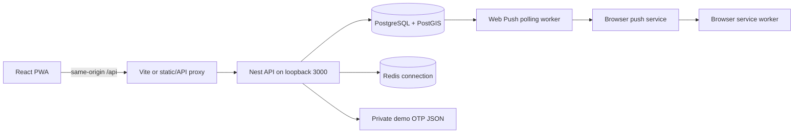

# Development and implementation guide

## Scope and navigation

This is an implementation reference for E don happen / Neighbourhood Signal at commit [`09db39d`](https://github.com/johdanike/group_9b/tree/09db39de1b8b761a369135badbb0802e9f730f99), on `demo/pitch-integration`. It describes implemented behavior and limitations, not all aspirations in the original product plan. A documentation-only merge does not install that implementation onto another branch. Source links below are pinned so they remain meaningful when this guide is merged independently. Reconcile this guide with code whenever the implementation changes.

- [Setup and commands](#setup-and-commands)
- [Architecture and concepts](#architecture-and-concepts)
- [Configuration](#configuration)
- [Identity and sessions](#identity-and-sessions)
- [Reports and community confidence](#reports-and-community-confidence)
- [Moderation](#moderation)
- [Subscriptions, inbox, and push](#subscriptions-inbox-and-push)
- [Frontend and PWA](#frontend-and-pwa)
- [API contract](#api-contract)
- [Persistence and source reference](#persistence-and-source-reference)
- [Tests and troubleshooting](#tests-and-troubleshooting)
- [Production release requirements](#production-release-requirements)
- [Complete source inventory](#complete-source-inventory)
- [Package and project configuration inventory](#package-and-project-configuration-inventory)

## Setup and commands

Prerequisites: Node.js 24, npm 11, Git, Docker Desktop running Linux containers. Use the integrated branch identified above. From the root, run `npm ci`; copy `backend/.env.example` to `backend/.env`; run `npm run db:up`, `npm run build`, `npm run demo:seed`, then `npm run dev`. Preserve existing environment files. Windows users may need `npm.cmd` instead of `npm`.

The npm root is a private workspace containing `backend` and `frontend`, with a shared lockfile. Install from the root so workspace scripts and hoisted CLI paths resolve consistently. Backend ESM imports use `.js` extensions in TypeScript because emitted code runs as Node ESM. Nest dependency injection builds services from module providers and injects TypeORM repositories; importing a TypeScript class alone does not register a provider.

| Root script | Behavior and requirements |
| --- | --- |
| `dev` | `scripts/dev.mjs` launches Nest's watch CLI in backend and Vite in frontend; Ctrl+C stops child process trees, using taskkill on Windows |
| `build` | Builds backend first, then frontend; output is backend/dist and frontend/dist |
| `test` | Runs backend Vitest unit suite; no standalone frontend unit suite exists |
| `test:e2e` | Loads backend/.env and runs scripts/demo.e2e.mjs against its own compiled API process and the configured demo database |
| `demo:seed` | Runs compiled seed; build and database must already be available |
| `db:up` | Docker Compose project signal-demo, starts dependencies and waits for health |
| `db:down` | Stops project containers, retains volumes |
| `demo:serve` | Serves compiled frontend with same-origin API proxy; does not start backend |
| `demo:share` | Starts cloudflared after checking the local static server is reachable |

Additional backend scripts: `start`, `start:dev`, `start:debug`, and `start:prod` run Nest/compiled server; `format` writes Prettier formatting; `lint` runs type-aware Oxlint; `test:watch`, `test:cov`, `test:debug` offer Vitest modes; `test:e2e` delegates to root. Prefer root `db:*` scripts over legacy backend `docker-compose` commands. Frontend `dev` binds all interfaces; `preview` binds loopback and is for inspecting builds, not a production hosting configuration.

Docker uses postgis/postgis:15-3.4 and redis:7-alpine. Host bindings are loopback 55432->5432 and 56379->6379, avoiding unrelated local databases. Database name is neighbourhood_signal_demo and local credentials are postgres/postgres. Named volumes postgres_data and redis_data are project-scoped. Initialization SQL runs only on a fresh database volume. Ordinary shutdown retains state; deleting volumes destroys local data.

### Sample data

The seed refuses to run unless demo mode is enabled, NODE_ENV is not production, and the database name is the expected demo name. It runs transactionally and preserves existing records. Ada (+2348000000001), Tunde (+2348000000002), Zainab (+2348000000003), and Bisi (+2348000000004, moderator) are fictional. Ada starts with nine backdated verified sample reports and audit records. Three sample observations and default subscriptions illustrate Yaba/Surulere flows. Re-running does not reset votes, decisions, or existing roles. No super-admin production bootstrap is implemented.

## Architecture and concepts



The normal request path is page event -> API helper -> controller -> guard/DTO validation -> service -> repository/transaction -> public response -> React state. Controllers define HTTP boundaries. DTO decorators validate incoming data. Services enforce ownership, business rules, transactions, and projections. Entities map stored fields and relationships. Guards authenticate and authorize requests. Module metadata wires these dependencies together.

The root application loads configuration, TypeORM, Redis, and domain modules. Identity, reports, notifications, and moderation contain the working core. Incidents, community, SOS, billing, and analytics contain retained entities/module scaffolding rather than complete user workflows. A schema declaration does not imply a working route or UI. Redis connects and closes through its infrastructure service; OTP state and Web Push queue execution currently do not use Redis.

PostGIS stores longitude/latitude in SRID 4326. GeoJSON coordinate order is [longitude, latitude], while many UI interfaces display latitude first. Geographic distance uses ST_DWithin with geography casts so distances are metres. A transaction commits related writes together; pessimistic row locks serialize competing report votes. These mechanisms protect consistency but do not replace abuse prevention or prove an observation true.

Report confidence (community votes), moderator verification (review decision), contributor history (ten currently verified reports), identity authentication (phone/session), and delivery acceptance (push provider response) are separate concepts.

## Configuration

Normal workspace execution uses backend as the API working directory. Config loads `.env.local` then `.env`; existing process environment takes precedence. Root integration tests explicitly load backend/.env. Never expose environment files, OTP mailbox contents, or VAPID private keys through static hosting.

| Variable | Default or example | Meaning |
| --- | --- | --- |
| NODE_ENV | development in example | Production disables demo OTP, key generation, and schema synchronization |
| PORT | 3000 | API port; API binds 127.0.0.1 |
| DB_HOST | localhost; example 127.0.0.1 | PostgreSQL host |
| DB_PORT | 55432 | Host PostgreSQL port |
| DB_USERNAME / DB_PASSWORD | postgres / postgres locally | Development credentials only |
| DB_NAME | neighbourhood_signal_demo | Seed requires this exact name |
| DB_LOGGING | false unless true | Enable TypeORM SQL logging |
| REDIS_HOST / REDIS_PORT | localhost / 56379 | Redis connection |
| JWT_SECRET | unsafe development fallback | Configure a strong access-token signing secret |
| JWT_REFRESH_SECRET | separate unsafe fallback | Configure a different refresh-token signing secret |
| JWT_ACCESS_EXPIRY | 15m in code; 2h in example | Access lifetime |
| JWT_REFRESH_EXPIRY | 7d | Refresh lifetime |
| DEMO_MODE | false unless true | Demo-only OTP and schema synchronization gates |
| CORS_ORIGIN | example http://127.0.0.1:5173 | Configured browser origin; not an authorization boundary |
| DEMO_OTP_FILE | .local/demo-otps.json | Private mailbox, relative to backend working directory |
| WEB_PUSH_PUBLIC_KEY / WEB_PUSH_PRIVATE_KEY | absent | VAPID pair required outside demo auto-generation |
| WEB_PUSH_SUBJECT | example mailto:demo@example.com | Push application contact identifier |
| DEMO_PUSH_KEYS_FILE | .local/web-push-keys.json | Persistent private development VAPID pair |
| WEB_PUSH_WORKER | enabled unless false | Disable worker polling when explicitly false |
| SHARE_HOST / SHARE_PORT | 0.0.0.0 / 4173 | Built frontend/proxy bind address and port |
| API_PORT | 3000 | Static proxy's loopback upstream |
| CLOUDFLARED_PATH | local tools lookup or PATH | Optional tunnel executable |

TypeORM synchronization runs only with DEMO_MODE=true and NODE_ENV other than production. Although a migration glob is configured, there are no implemented versioned migration files or migration CLI/data-source workflow. Disabling synchronization alone does not provision a production schema. `start:prod` runs `node dist/main.js`; set NODE_ENV explicitly through the deployment environment.

## Identity and sessions

The frontend requests an OTP; only the backend generates it using cryptographic randomness. OTP values are held in process memory and, in demo mode, written atomically through a temporary JSON file and rename. The API response never includes the code. Read backend/.local/demo-otps.json on the host, then enter the code in the client. This is a local demonstration transport, not SMS delivery.

A code lasts five minutes, allows three failed attempts, and each phone can request three sends in fifteen minutes. Cleanup occurs during sends. Successful verification removes the mailbox entry. An expired code can remain physically in the file until another write, but cannot authenticate. Restarting the backend loses its authoritative in-memory codes; request another code rather than trusting a stale file. Multiple backend instances do not share OTP state. There is no IP/device rate limiter. Outside nonproduction demo mode, send-otp returns 503 because no SMS adapter is configured.

Verification creates a resident when necessary, updates last login, activates pending accounts, and rejects banned, suspended, or deactivated accounts. Access and refresh JWTs use distinct secrets. JWTs are signed, not encrypted. Claims include user ID, phone, role, and community; request authentication reloads the user from the database and checks active status. Role decisions therefore use the current stored user, not just an old token claim.

The API client stores tokens under `signal:session` in sessionStorage, sends Bearer authorization, shares one in-flight refresh promise across failed requests, retries once after refresh, and clears the session if refresh fails. There are no authentication cookies, refresh rotation/revocation, or server-side logout. Browser script access to storage makes XSS prevention important. Closing/replacing a browser session or opening an installed PWA may require signing in again.

Frontend phone normalization converts an eleven-digit Nigerian number beginning with 0 to +234 and removes formatting. The backend does not guarantee equivalent canonical normalization for all clients, so a unique raw phone column is not complete protection against equivalent-number duplicates.

Profiles expose own phone, display name, role, status, areas, language, verified-report count, and trustedContributor. Profile updates accept supported pilot areas (maximum three), language, name, and privacy settings; they do not grant roles. Administrative assignment routes require super_admin; suspension/ban/reactivation require moderator or super_admin. Some inline TypeScript bodies lack class-validator DTO validation. The inherited moderation action-update fallback trusts privacySettings.isAdmin, while privacy settings are writable: this unfinished authorization path must be fixed before deployment.

## Reports and community confidence

Categories are traffic, weather, fire, security, medical, utilities, community, event, and other. A report requires a description of 10-1500 characters and a location with valid longitude/latitude ranges. Optional observedAt must be ISO and cannot exceed now by over sixty seconds. Evidence reference fields exist but nonempty evidence arrays are rejected: media ingestion is not implemented. Persisted location precision is approximate; public coordinates are rounded to two decimals. Public reporter projections omit phone and private metadata.

Creation saves the report and matching inbox rows in a single database transaction. Read queries expose only unverified, corroborated, verified, disputed, and resolved states. Under-review, stale, and removed rows are excluded from the public feed. Filters include category, state, since, paired latitude/longitude, radius, limit, and offset. Defaults are limit 20, maximum 100; radius ranges from 100 to 100000 metres. A radius alone has no location centre; coordinates without radius do not apply a distance restriction. Results sort by newest submission. Zero coordinates are valid.

Only the owner can edit/delete. Edits are limited to unverified reports; deletion changes the state to removed. The edit implementation ignores a falsy empty description rather than clearing it. Deleted records remain stored. Vote records have a unique user/report key. Authors cannot vote on their own reports; confirmations require firsthand=true, while disputes may use false. A transaction locks the report, upserts the vote, and recounts confirms/disputes. Repeated votes update one row rather than create multiple witnesses.

Two independent confirmations produce corroborated. Any dispute produces disputed unless the report is already verified; community votes alone do not overturn verification. Stale, resolved, and removed reports reject votes. Under-review is not a closed voting state in the current code; a vote may reset that state, which requires policy review. Contributor status is calculated dynamically from at least ten distinct reports currently verified by moderation; changes to report states can remove the badge. The badge is not identity verification. Public feed enrichment currently performs additional count queries per reporter/report and will need optimization for scale.

## Moderation

All moderation controller routes require a current moderator or super_admin. Actor identity comes from the authenticated user. The main action service checks the actor again, rejects self-review, validates transitions, and saves the report and action record transactionally. Approve defaults to verified and remove defaults to removed; other actions require a new state.

| Current state | Allowed next states |
| --- | --- |
| unverified | under_review, corroborated, verified, disputed, removed |
| under_review | corroborated, verified, disputed, unverified, removed |
| corroborated | verified, disputed, resolved, removed |
| verified | disputed, resolved, removed |
| disputed | corroborated, verified, unverified, removed |
| stale | resolved, removed |
| resolved | removed |
| removed | none |

The queue returns up to 100 raw report rows in unverified/disputed/corroborated states, newest first. It does not scope results by community, and the supplied moderator/target filters are not implemented. Some advertised Swagger response shapes differ from this actual array. The main action DTO requires a 10-1000 character reason; several quick-action bodies are inline types and do not have equivalent runtime validation.

Audit records are not immutable: updateAction permits owner edits and contains the unsafe privacySettings.isAdmin fallback described above. Appeals are incomplete: creation stores metadata without full ownership/duplicate checks, the controller is moderator-only, review returns 501, and residents have no working appeal flow. Merge reports and incident verify/dispute return 501; moderator stats currently return an empty object. The flag shortcut does not supply the state required by the core action handler and fails. Do not advertise these scaffold endpoints as finished features. No automatic stale/resolution scheduler or complete incident grouping workflow exists.

## Subscriptions, inbox, and push

A subscription uses a composite user/category key and stores a centre, radius in kilometres (0.1-100), priority, and optional quiet hours. Default centre is approximately Lagos (6.5244, 3.3792). The UI uses selected pilot-area centres and typically five kilometres. Category preference changes are scoped to the authenticated user. The current read-then-save subscription upsert can race against the composite key; production needs an atomic upsert.

New reports have normal priority. Matching excludes the reporter, checks category, geographic distance from each saved centre, and quiet hours, then writes a durable local inbox job in the report transaction. The job has channel in_app, provider local-inbox, deliveryState delivered, and pushState queued. Quiet hours use the server's local getHours/getDay timezone, not an explicit per-user zone. Time-string helpers do not guarantee full runtime validation of subscription quiet-hour input. In-app read acknowledgment preserves timestamps and is unrelated to emergency responder acknowledgment.

The dashboard polls the inbox every twenty seconds and supports manual refresh. The inbox endpoint currently has no pagination. Legacy generic delivery routes retain provider labels such as FCM, Twilio, SendGrid, and Africa's Talking; those labels do not mean provider integrations are installed. Their cooldown/deduplication logic is not an atomic cross-instance event grouping mechanism. Only the Web Push path described here actively dispatches report alerts.

### Web Push lifecycle

1. An authenticated client requests the public VAPID configuration. In demo mode a persistent key pair is generated in the ignored private backend/.local directory. Production requires configured keys; without them push is disabled.
2. A user clicks enable. The browser permission request occurs before asynchronous work for Safari compatibility. The helper waits for an active service worker, subscribes with userVisibleOnly and the public key, and posts the endpoint and encryption keys to the backend.
3. The backend accepts HTTPS endpoints only from supported Apple, Mozilla, Google, or Windows push hosts, without credentials or unusual ports. Key shapes are validated. Endpoint uniqueness permits rebinding a browser endpoint to its current signed-in user.
4. Every three seconds, the worker claims up to twenty due jobs. Database row locks with skip-locked behavior prevent competing workers from claiming a row simultaneously. A claim increments attempts and leases a sending row for 120 seconds before the network operation.
5. Devices registered after a job was created do not receive that old alert. The worker encrypts payloads and sends through web-push with TTL 300 seconds, a seven-second timeout, and normal urgency. Titles/bodies are truncated and tags identify the delivery.
6. Expired endpoints (404/410) are removed. Transient network/429/5xx errors retry with a thirty-second multiplier, up to three attempts. Expired final sending leases become failed. A retry can repeat delivery to a device that already succeeded; tags reduce visible duplicates. This is at-least-once behavior, not exactly-once delivery.
7. States distinguish accepted, no_device, retry, and failed. Provider acceptance is not a device display receipt. Read state is independent. Shutdown clears the timer but does not implement a complete in-flight worker drain.

The test-push endpoint targets only an endpoint owned by the current user. Disabling notifications unsubscribes locally and deletes the backend device record. Existing browser subscriptions are restored on sign-in; sign-out attempts cleanup before removing the session. Stable VAPID keys and a stable HTTPS origin are necessary for a persistent installation.

## Frontend and PWA

The React entry mounts App with routing. Routes are / (landing), /login, /register, and /dashboard; unknown paths fall back to the landing view rather than a dedicated 404. Login and registration share authentication UI. Registration verifies the phone, saves the profile, then creates category subscriptions. Those independent calls are not one transaction, so partial completion is possible. A consent checkbox is a demonstration acknowledgment, not a complete legal/consent management system.

Dashboard loads profile, reports, subscriptions, inbox, and optionally moderation queue; shared action handling tracks loading/errors and reloads data. Report publishing uses a preview before submission. Confirmation asks the user to attest firsthand knowledge. Report links use a UUID query parameter; notification clicks navigate to the selected report and authentication preserves the query path. The moderation UI offers a subset of backend states with reasons. The 'My reports' tab filters the currently loaded feed (up to 100), not a complete historical report query.

Pilot areas are Yaba, Ikeja, Surulere, Eti-Osa, Lagos Island, and Ikorodu with manually specified centres. This is not live GPS, a geocoder, or a complete map interface. Legacy LGA selector/data files remain in the tree but do not define the current registration flow. Category/help labels are shared data. Styling uses Tailwind and existing design tokens, including primary green #12d900 and dark #303234. Landing-page marketing copy and testimonials are not evidence of implemented backend capabilities; legal/footer placeholders require product review.

### Service worker and installation

Vite's PWA plugin uses injectManifest to compile the custom service worker. Workbox precaches built shell assets, removes outdated caches, claims clients, and activates updates. Navigation falls back to the app shell except /api. API responses are not cached; there are no offline report writes, background sync, or offline inbox guarantees.

Push handlers call showNotification with title, body, icon, badge, tag, and target URL. Click handling permits same-origin destinations and focuses/navigates an existing window or opens one. The UI handles beforeinstallprompt where supported and supplies iOS installation guidance. Browser APIs require a secure context, service workers, PushManager, and Notification support. Apple mobile Web Push requires an installed Home Screen web app on supported iOS/iPadOS (16.4+); browser permission remains user-controlled. OS focus modes and settings can suppress presentation.

### Serving and sharing

Build both workspaces, start the compiled backend, then run npm run demo:serve. scripts/serve-demo.mjs serves frontend/dist and proxies /api to loopback backend. It restricts static requests to GET/HEAD, rejects dot/@ segments and path escapes, uses MIME types, returns 404 for missing assets, and serves index.html for extensionless routes. Shell/service-worker/manifest responses avoid caching; other assets have an hour cache. Upstream failures return 502 and requests have a thirty-second timeout. This lightweight server is not a complete hardened production ingress.

For temporary phone access, install cloudflared or supply CLOUDFLARED_PATH and run npm run demo:share. The launcher checks local readiness, starts a Quick Tunnel using HTTP/2, prints the HTTPS URL, and records it in ignored .local/share-url.txt. Keep the machine awake, database/API/static server/tunnel running. The temporary origin changes when recreated; users must reinstall/resubscribe for a new origin. The public URL exposes the application and API, so use synthetic data and understand that the link is public. The OTP file is outside the served frontend root. Localhost on another device refers to that device, not this computer. Plain LAN HTTP is inadequate for most PWA/push features.

## API contract

The global prefix is `/api`; Swagger is `/api/docs`. Requests use JSON and Bearer access tokens where protected. Global ValidationPipe transforms and strips/rejects unexpected fields through whitelist + forbidNonWhitelisted. These checks apply to decorated DTO classes, not erased inline TypeScript interfaces. UUID pipes validate applicable report route IDs. Standard Nest exceptions carry statusCode/message/error. Controller POSTs default to 201 unless HttpCode overrides them; GET/PUT/DELETE default to 200. Subscription deletion explicitly returns 204. Report deletion returns a message with 200. Some legacy getters return null with 200 rather than the 404 advertised in Swagger.

The route inventory below lists actual controller decorators, method parameter types, guards, role metadata, and explicit status overrides. Authentication decorators on a controller apply to all methods; method role metadata overrides controller role defaults. Notifications defaults to super_admin but user-facing inbox/subscription methods explicitly admit all user roles. The user-deliveries route uses the authenticated ID even though its URL includes userId. Use the symbol inventory for the exact request DTO fields and validators.

### Typical requests

```http
POST /api/auth/send-otp
Content-Type: application/json

{"phone":"+2348000000001"}
```

Read the private host mailbox, then POST /api/auth/verify-otp with `phone` and `otp`. The frontend stores the returned session and uses its access token. POST /api/auth/refresh takes refreshToken and returns a new access token.

```http
POST /api/reports
Authorization: Bearer <access-token>
Content-Type: application/json

{"category":"traffic","description":"Traffic is moving slowly near the junction.","location":{"latitude":6.5158,"longitude":3.3711,"areaName":"Yaba"}}
```

GET /api/reports?latitude=6.5158&longitude=3.3711&radius=5000&limit=20 retrieves nearby public reports. POST /api/reports/confirm accepts `{"reportId":"<report-uuid>","action":"confirm","firsthand":true}` using the vote DTO shown below; verify its declared fields rather than inventing an upvote integer. A moderator should use the action DTO and an allowed state transition. Do not send actor IDs as proof of permission: authentication determines the actor.


### Controller route inventory

#### AppController

Source: [backend/src/app.controller.ts](https://github.com/johdanike/group_9b/blob/09db39de1b8b761a369135badbb0802e9f730f99/backend/src/app.controller.ts). Controller metadata: `Controller()`.

| Handler | HTTP decorator | Guards, roles, status | Parameters |
| --- | --- | --- | --- |
| getHello | Get() | Inherited/default |  |
#### AuthController

Source: [backend/src/modules/identity/controllers/auth.controller.ts](https://github.com/johdanike/group_9b/blob/09db39de1b8b761a369135badbb0802e9f730f99/backend/src/modules/identity/controllers/auth.controller.ts). Controller metadata: `ApiTags('auth')`; `Controller('auth')`.

| Handler | HTTP decorator | Guards, roles, status | Parameters |
| --- | --- | --- | --- |
| sendOtp | Post('send-otp') | HttpCode(HttpStatus.OK) | Body() sendOtpDto: SendOtpDto |
| verifyOtp | Post('verify-otp') | HttpCode(HttpStatus.OK) | Body() verifyOtpDto: VerifyOtpDto |
| refreshToken | Post('refresh') | HttpCode(HttpStatus.OK) | Body() refreshTokenDto: RefreshTokenDto |
| getProfile | Get('profile') | UseGuards(AuthGuard('jwt')) | Request() req: any |
| updateProfile | Put('profile') | UseGuards(AuthGuard('jwt')) | Request() req: any; Body() updateProfileDto: UpdateProfileDto |
| completeProfile | Put('complete-profile') | UseGuards(AuthGuard('jwt')) | Request() req: any; Body() completeProfileDto: CompleteProfileDto |
| assignResponder | Post('assign-responder') | UseGuards(AuthGuard('jwt'), RolesGuard); Roles(UserRole.SUPER_ADMIN) | Request() req: any; Body() body: { userId: string; communityId: string } |
| assignModerator | Post('assign-moderator') | UseGuards(AuthGuard('jwt'), RolesGuard); Roles(UserRole.SUPER_ADMIN) | Request() req: any; Body() body: { userId: string } |
| assignCommunityAdmin | Post('assign-community-admin') | UseGuards(AuthGuard('jwt'), RolesGuard); Roles(UserRole.SUPER_ADMIN) | Request() req: any; Body() body: { userId: string; communityId: string } |
| suspendUser | Post('suspend') | UseGuards(AuthGuard('jwt'), RolesGuard); Roles(UserRole.MODERATOR, UserRole.SUPER_ADMIN) | Request() req: any; Body() body: { userId: string; reason?: string } |
| banUser | Post('ban') | UseGuards(AuthGuard('jwt'), RolesGuard); Roles(UserRole.MODERATOR, UserRole.SUPER_ADMIN) | Request() req: any; Body() body: { userId: string; reason?: string } |
| reactivateUser | Post('reactivate') | UseGuards(AuthGuard('jwt'), RolesGuard); Roles(UserRole.MODERATOR, UserRole.SUPER_ADMIN) | Request() req: any; Body() body: { userId: string } |
| deactivateSelf | Post('deactivate') | UseGuards(AuthGuard('jwt')) | Request() req: any |
#### ModerationController

Source: [backend/src/modules/moderation/moderation.controller.ts](https://github.com/johdanike/group_9b/blob/09db39de1b8b761a369135badbb0802e9f730f99/backend/src/modules/moderation/moderation.controller.ts). Controller metadata: `ApiTags('Moderation')`; `ApiBearerAuth()`; `Controller('moderation')`; `UseGuards(AuthGuard('jwt'), RolesGuard)`; `Roles(UserRole.MODERATOR, UserRole.SUPER_ADMIN)`.

| Handler | HTTP decorator | Guards, roles, status | Parameters |
| --- | --- | --- | --- |
| createAction | Post('actions') | Inherited/default | Body() dto: CreateModerationActionDto; CurrentUserId() actorId: string |
| getAction | Get('actions/:id') | Inherited/default | Param('id') id: string |
| updateAction | Put('actions/:id') | Inherited/default | Param('id') id: string; Body() dto: UpdateModerationActionDto; CurrentUserId() actorId: string |
| filterActions | Get('actions') | Inherited/default | Query() filters: ModerationActionFilterDto |
| getQueue | Get('queue') | Inherited/default | CurrentUserId() moderatorId: string; Query('targetType') targetType: ModerationTargetType |
| createAppeal | Post('appeals') | Inherited/default | Body() dto: CreateAppealDto; CurrentUserId() userId: string |
| reviewAppeal | Put('appeals/:id/review') | Inherited/default | Param('id') id: string; Body() dto: ReviewAppealDto; CurrentUserId() moderatorId: string |
| getPendingAppeals | Get('appeals/pending') | Inherited/default |  |
| mergeReports | Post('reports/merge') | Inherited/default | Body() dto: MergeReportsDto; CurrentUserId() moderatorId: string |
| getAuditTrail | Get('audit/:targetId') | Inherited/default | Param('targetId') targetId: string |
| getModeratorStats | Get('stats/:moderatorId') | Inherited/default | Param('moderatorId') moderatorId: string; Query('since') since: string |
| quickApprove | Post('reports/:id/approve') | Inherited/default | Param('id') id: string; CurrentUserId() actorId: string; Body() body: { newState?: string; reason: string } |
| quickReject | Post('reports/:id/reject') | Inherited/default | Param('id') id: string; CurrentUserId() actorId: string; Body() body: { reason: string } |
| flagReport | Post('reports/:id/flag') | Inherited/default | Param('id') id: string; CurrentUserId() actorId: string; Body() body: { reason: string } |
| verifyIncident | Post('incidents/:id/verify') | Inherited/default | Param('id') id: string; CurrentUserId() actorId: string; Body() body: { reason: string; severity?: string } |
| disputeIncident | Post('incidents/:id/dispute') | Inherited/default | Param('id') id: string; CurrentUserId() actorId: string; Body() body: { reason: string } |
#### NotificationsController

Source: [backend/src/modules/notifications/notifications.controller.ts](https://github.com/johdanike/group_9b/blob/09db39de1b8b761a369135badbb0802e9f730f99/backend/src/modules/notifications/notifications.controller.ts). Controller metadata: `ApiTags('Notifications')`; `Controller('notifications')`; `UseGuards(AuthGuard('jwt'), RolesGuard)`; `Roles(UserRole.SUPER_ADMIN)`.

| Handler | HTTP decorator | Guards, roles, status | Parameters |
| --- | --- | --- | --- |
| inbox | Get('inbox') | Roles(...Object.values(UserRole)) | CurrentUserId() userId: string |
| read | Put('inbox/:id/read') | Roles(...Object.values(UserRole)) | Param('id') id: string; CurrentUserId() userId: string |
| createSubscription | Post('subscriptions') | Roles(...Object.values(UserRole)) | Body() dto: CreateNotificationSubscriptionDto; CurrentUserId() userId: string |
| getSubscriptions | Get('subscriptions') | Roles(...Object.values(UserRole)) | CurrentUserId() userId: string |
| getSubscription | Get('subscriptions/:category') | Roles(...Object.values(UserRole)) | CurrentUserId() userId: string; Param('category') category: string |
| updateSubscription | Put('subscriptions/:category') | Roles(...Object.values(UserRole)) | CurrentUserId() userId: string; Param('category') category: string; Body() dto: UpdateNotificationSubscriptionDto |
| deleteSubscription | Delete('subscriptions/:category') | Roles(...Object.values(UserRole)); HttpCode(HttpStatus.NO_CONTENT) | CurrentUserId() userId: string; Param('category') category: string |
| enqueueNotification | Post('enqueue') | Inherited/default | Body() params: EnqueueNotificationParams |
| getPendingDeliveries | Get('deliveries/pending') | Inherited/default | Query('limit') limit: number |
| getDelivery | Get('deliveries/:id') | Inherited/default | Param('id') id: string |
| filterDeliveries | Get('deliveries') | Inherited/default | Query() filters: NotificationDeliveryFilterDto |
| getDeliveriesByIncident | Get('deliveries/incident/:incidentId') | Inherited/default | Param('incidentId') incidentId: string |
| getDeliveriesByRecipient | Get('deliveries/user/:userId') | Roles(...Object.values(UserRole)) | CurrentUserId() userId: string |
| markSent | Put('deliveries/:id/sent') | Inherited/default | Param('id') id: string; Body() body: { providerResponse?: any } |
| markDelivered | Put('deliveries/:id/delivered') | Inherited/default | Param('id') id: string; Body() body: { providerResponse?: any } |
| markFailed | Put('deliveries/:id/failed') | Inherited/default | Param('id') id: string; Body() body: { error: string; willRetry: boolean } |
| markAcknowledged | Put('deliveries/:id/acknowledged') | Inherited/default | Param('id') id: string |
| retryFailedDeliveries | Post('deliveries/retry') | Inherited/default | Query('maxAttempts') maxAttempts: number |
| getDeliveryStats | Get('stats') | Inherited/default | Query('since') since: string |
#### WebPushController

Source: [backend/src/modules/notifications/web-push.controller.ts](https://github.com/johdanike/group_9b/blob/09db39de1b8b761a369135badbb0802e9f730f99/backend/src/modules/notifications/web-push.controller.ts). Controller metadata: `Controller('notifications/push')`; `UseGuards(AuthGuard('jwt'))`.

| Handler | HTTP decorator | Guards, roles, status | Parameters |
| --- | --- | --- | --- |
| configuration | Get('config') | Inherited/default |  |
| save | Post('devices') | Inherited/default | CurrentUserId() userId: string; Body() dto: SavePushDeviceDto |
| remove | Delete('devices') | Inherited/default | CurrentUserId() userId: string; Body() dto: PushEndpointDto |
| test | Post('test') | HttpCode(200) | CurrentUserId() userId: string; Body() dto: PushEndpointDto |
#### ReportsController

Source: [backend/src/modules/reports/controllers/reports.controller.ts](https://github.com/johdanike/group_9b/blob/09db39de1b8b761a369135badbb0802e9f730f99/backend/src/modules/reports/controllers/reports.controller.ts). Controller metadata: `Controller('reports')`.

| Handler | HTTP decorator | Guards, roles, status | Parameters |
| --- | --- | --- | --- |
| createReport | Post() | UseGuards(AuthGuard('jwt')) | Request() req: any; Body() createReportDto: CreateReportDto |
| getFeed | Get() | Inherited/default | Query() query: FeedQueryDto |
| getReport | Get(':id') | Inherited/default | Param('id', ParseUUIDPipe) id: string |
| updateReport | Put(':id') | UseGuards(AuthGuard('jwt')) | Request() req: any; Param('id', ParseUUIDPipe) id: string; Body() updateReportDto: UpdateReportDto |
| addConfirmation | Post('confirm') | UseGuards(AuthGuard('jwt')) | Request() req: any; Body() confirmationDto: ConfirmationDto |
| deleteReport | Delete(':id') | UseGuards(AuthGuard('jwt')) | Request() req: any; Param('id', ParseUUIDPipe) id: string |

## Persistence and source reference

Entity decorators in the inventory below are the schema reference: Entity names identify tables; Column includes database names, SQL types, lengths, defaults, and nullability; PrimaryGeneratedColumn produces generated IDs; PrimaryColumn defines composite keys; Index/Unique define declared constraints; ManyToOne/OneToMany/JoinColumn describe relationships. A TypeScript optional marker alone does not establish database nullability. jsonb stores structured metadata without automatically validating its shape. timestamptz stores instants; presentation timezone is a separate concern.

Core relationships are users -> reports, reports/users -> confirmations, users -> notification_subscriptions/push_devices, and actors/targets -> moderation_actions. Notification deliveries link recipients to report-triggered payloads; some inherited columns retain incident/SOS names even when used for report IDs. Retained domain entities include incident grouping/linking, evidence, communities/membership/responders, SOS/escalations, billing plans/subscriptions/usage, and analytics. These tables and relation declarations are reference scaffolding, not complete product integrations.

## Tests and troubleshooting

For runtime changes, run `npm run build`, `npm test`, `npm run lint --workspace backend`, and relevant integration checks. The HTTP suite needs Docker services and the compiled backend. It starts its own backend on port 3100 with Web Push polling disabled, uses the guarded demo database, creates synthetic accounts, and cleans its rows and test OTP file in teardown. It writes ignored .local/api-test.log. The guard checks DEMO_MODE and the exact demo database name, but do not point it at valuable data merely because those names match. Root .local must exist for private artifacts. Forced termination can prevent cleanup. The suite is not an isolated disposable database per run.

Vitest covers the app controller, OTP behavior, moderation controllers/services/repositories, notification controllers/services/repositories, and Web Push queue/provider behavior. Report rules are exercised through the HTTP integration suite. The exact case names are listed per test file below. Mock provider tests verify application behavior, not every OS/browser's notification presentation. HTTP tests exercise authentication, public projections, invalid inputs, votes, moderation, notifications, and stored data boundaries. There is no complete automated browser accessibility/UI suite or real SMS integration test. Documentation-only changes need link/content validation rather than unrelated runtime tests.

| Symptom | Investigation |
| --- | --- |
| Cannot connect to database/Redis | Start Docker, run root db:up, check ports 55432/56379 and backend/.env; inspect docker compose -p signal-demo ps/logs |
| Missing PostGIS/schema | Check fresh-volume initialization and DEMO_MODE; existing volumes do not rerun init SQL; production needs migrations |
| API not reachable | Start backend, check 127.0.0.1:3000/api and logs; ensure proxy API_PORT matches |
| Phone cannot open localhost | Use the shared HTTPS URL; phone localhost is not the host computer |
| OTP rejected after restart | Request a fresh code; private JSON is a mailbox, not authoritative storage |
| OTP limited | Reuse a signed-in session or wait for the fifteen-minute window; do not weaken limits for ordinary use |
| Authentication 503 | Demo OTP is disabled or NODE_ENV is production; SMS adapter does not exist yet |
| Stale frontend after edit | Development uses Vite; built serving requires rebuild; inspect installed service-worker/cache state |
| Missing notification | Check saved category/centre/radius, reporter exclusion, quiet hours/server timezone, inbox, permission, device ownership and registration time |
| Push unavailable | Require HTTPS, active service worker, compatible browser, configured VAPID pair, explicit user permission; on Apple mobile use installed app |
| Provider accepted but no banner | Check OS permission/focus/browser settings; accepted is not display confirmation |
| Temporary link expired | Restart local services/tunnel and use current URL; new origin requires installation/subscription again |
| Port 3100 in use during tests | Stop the conflicting test process; integration suite launches its own backend |
| PowerShell refuses npm | Use npm.cmd; do not change machine policy just for the repository |

## Production release requirements

This implementation has development defaults and incomplete security/operations paths. A production deployment is new engineering work, not just a different start command.

1. Resolve authorization gaps: remove writable privacySettings.isAdmin trust, validate administrative/quick-action DTOs, scope moderator access, define appeal ownership, prevent self/duplicate abuse, and review role bootstrap and account lifecycle policies.
2. Implement real SMS delivery and canonical phone normalization; move OTP/rate-limit state to shared storage; add IP/device throttles, fraud controls, refresh rotation/revocation, secret validation, and appropriate security headers/CSP.
3. Build reviewed versioned migrations, create PostGIS deliberately, use least-privilege credentials, disable synchronize, and test upgrades/rollback on a copy. Add encrypted backups, retention policy, and restore drills. Avoid treating database down as backup.
4. Deploy a stable HTTPS origin with TLS termination/reverse proxy, same-origin /api routing, correct CORS, explicit NODE_ENV=production, managed secrets, persistent VAPID keys, and nonpublic database/Redis. The loopback API needs an ingress proxy on the same host or an explicit binding redesign for separate containers.
5. Containerize or supervise processes, add health/readiness checks, structured redacted logs, error tracking, metrics, graceful worker drain, and push retry/queue monitoring. Installed telemetry dependencies do not mean telemetry is configured.
6. Review indexes/query plans and per-report profile-count queries, paginate inbox/history, use atomic subscription upserts/deduplication, add load/concurrency tests, and establish Web Push provider/browser acceptance tests. Decide under-review vote policy and local timezone handling.
7. Finish or disable incomplete endpoints: appeals/review, merge, incident moderation, stats, legacy channel dispatch, media uploads, SOS/responders, billing, and analytics. Decide badge wording and false-report/abuse handling with the product owner.
8. Establish CI checks, environment-separated deployment, dependency review, accessibility/browser testing, explicit licensing, privacy/consent/terms, deletion/retention procedures, and real incident escalation disclaimers in product policy. Do not imply emergency dispatch currently exists.

There are no committed Dockerfiles, migration workflow, or deployment CI pipeline in this snapshot. Keep public development docs separate from private walkthroughs, .env files, OTPs, VAPID private keys, tunnel artifacts, and the original private product plan.

## Complete source inventory

This inventory covers every tracked TS/JS/JSX/MJS file in the integrated snapshot, including tests and configuration modules. Source links show complete executable bodies. Imports identify dependencies; class decorators identify wiring; fields include persistence/validation metadata; methods/functions identify callable units. Nested helpers are included where parsed. Signatures are compact navigation summaries (object/destructuring syntax may be shortened); the pinned source is authoritative for complete signatures, branching, return types, and algorithms. This appendix complements the behavior explanations above rather than claiming every declared method is fully implemented.

Decorator reading: IsOptional skips other validators for absent values; IsEnum/IsIn constrain choices; Min/Max constrain numbers; MinLength/MaxLength constrain strings; ValidateNested plus Type instantiate/validate nested DTOs. InjectRepository selects an entity repository. UseGuards applies authentication/authorization. Roles supplies role metadata read by RolesGuard. Api* decorators describe Swagger, not enforcement. Module imports/providers/controllers/exports establish dependency-injection visibility. Tests' describe/test strings state their intended assertions; consult the linked body for assertion details.

### backend/src/app.controller.spec.ts

[View source](https://github.com/johdanike/group_9b/blob/09db39de1b8b761a369135badbb0802e9f730f99/backend/src/app.controller.spec.ts) (23 lines).

Imports: `{ Test, TestingModule }` from `@nestjs/testing`; `{ AppController }` from `./app.controller.js`; `{ AppService }` from `./app.service.js`.

Test groups/cases:

- AppController
- root
- should return "Hello World!"

This file contains declarative definitions or module-level initialization/test setup; inspect the linked source for literal values and execution details.

### backend/src/app.controller.ts

[View source](https://github.com/johdanike/group_9b/blob/09db39de1b8b761a369135badbb0802e9f730f99/backend/src/app.controller.ts) (13 lines).

Imports: `{ Controller, Get }` from `@nestjs/common`; `{ AppService }` from `./app.service.js`.

**AppController**: `Controller()`

| Symbol | Kind / type | Metadata or signature |
| --- | --- | --- |
| constructor | constructor | constructor(private readonly appService: AppService) |
| getHello | method / string | Get() @Get() getHello(): string |

### backend/src/app.module.ts

[View source](https://github.com/johdanike/group_9b/blob/09db39de1b8b761a369135badbb0802e9f730f99/backend/src/app.module.ts) (41 lines).

Imports: `{ Module }` from `@nestjs/common`; `{ ConfigModule }` from `@nestjs/config`; `{ AppController }` from `./app.controller.js`; `{ AppService }` from `./app.service.js`; `{ DatabaseModule }` from `./database/database.module.js`; `{ IdentityModule }` from `./modules/identity/identity.module.js`; `{ ReportsModule }` from `./modules/reports/reports.module.js`; `{ IncidentsModule }` from `./modules/incidents/incidents.module.js`; `{ NotificationsModule }` from `./modules/notifications/notifications.module.js`; `{ SosModule }` from `./modules/sos/sos.module.js`; `{ CommunityModule }` from `./modules/community/community.module.js`; `{ ModerationModule }` from `./modules/moderation/moderation.module.js`; `{ BillingModule }` from `./modules/billing/billing.module.js`; `{ AnalyticsModule }` from `./modules/analytics/analytics.module.js`; `{ RedisModule }` from `./redis/redis.module.js`; `appConfig` from `./config/app.config.js`.

**AppModule**: `Module({ imports: [ ConfigModule.forRoot({ isGlobal: true, load: [appConfig], envFilePath: ['.env.local', '.env'], }), DatabaseModule, RedisModule, IdentityModule, ReportsModule, IncidentsModule, NotificationsModule, SosModule, CommunityModule, ModerationModule, BillingModule, AnalyticsModule, ], controllers: [AppController], providers: [AppService], })`

### backend/src/app.service.ts

[View source](https://github.com/johdanike/group_9b/blob/09db39de1b8b761a369135badbb0802e9f730f99/backend/src/app.service.ts) (9 lines).

Imports: `{ Injectable }` from `@nestjs/common`.

**AppService**: `Injectable()`

| Symbol | Kind / type | Metadata or signature |
| --- | --- | --- |
| getHello | method / string | getHello(): string |

### backend/src/config/app.config.ts

[View source](https://github.com/johdanike/group_9b/blob/09db39de1b8b761a369135badbb0802e9f730f99/backend/src/config/app.config.ts) (18 lines).

This file contains declarative definitions or module-level initialization/test setup; inspect the linked source for literal values and execution details.

### backend/src/config/database.config.ts

[View source](https://github.com/johdanike/group_9b/blob/09db39de1b8b761a369135badbb0802e9f730f99/backend/src/config/database.config.ts) (30 lines).

Imports: `{ DataSourceOptions }` from `typeorm`; `{ fileURLToPath }` from `url`; `{ dirname, join }` from `path`; `appConfig` from `./app.config.js`.

Functions/helpers:

- `databaseConfig` (line 9): `databaseConfig = (): DataSourceOptions =>`.

### backend/src/database/database.module.ts

[View source](https://github.com/johdanike/group_9b/blob/09db39de1b8b761a369135badbb0802e9f730f99/backend/src/database/database.module.ts) (20 lines).

Imports: `{ Module, Global }` from `@nestjs/common`; `{ TypeOrmModule }` from `@nestjs/typeorm`; `{ ConfigModule, ConfigService }` from `@nestjs/config`; `{ databaseConfig }` from `../config/database.config.js`.

**DatabaseModule**: `Global()`; `Module({ imports: [ TypeOrmModule.forRootAsync({ imports: [ConfigModule], useFactory: (configService: ConfigService) => { const config = databaseConfig(); return config; }, inject: [ConfigService], }), ], exports: [TypeOrmModule], })`

### backend/src/demo/seed.ts

[View source](https://github.com/johdanike/group_9b/blob/09db39de1b8b761a369135badbb0802e9f730f99/backend/src/demo/seed.ts) (195 lines).

Imports: `side effect` from `reflect-metadata`; `{ NestFactory }` from `@nestjs/core`; `{ DataSource }` from `typeorm`; `{ AppModule }` from `../app.module.js`; `{ User }` from `../modules/identity/entities/user.entity.js`; `{ UserRole, AccountStatus, }` from `../modules/identity/interfaces/identity.interface.js`; `{ Report }` from `../modules/reports/entities/report.entity.js`; `{ NotificationSubscription }` from `../modules/notifications/entities/notification-subscription.entity.js`; `{ NotificationDelivery }` from `../modules/notifications/entities/notification-delivery.entity.js`; `{ ModerationAction }` from `../modules/moderation/entities/moderation-action.entity.js`.

This file contains declarative definitions or module-level initialization/test setup; inspect the linked source for literal values and execution details.

### backend/src/main.ts

[View source](https://github.com/johdanike/group_9b/blob/09db39de1b8b761a369135badbb0802e9f730f99/backend/src/main.ts) (33 lines).

Imports: `{ NestFactory }` from `@nestjs/core`; `{ ValidationPipe }` from `@nestjs/common`; `{ SwaggerModule, DocumentBuilder }` from `@nestjs/swagger`; `{ AppModule }` from `./app.module.js`.

Functions/helpers:

- `bootstrap` (line 6): `async function bootstrap()`.

### backend/src/modules/analytics/analytics.module.ts

[View source](https://github.com/johdanike/group_9b/blob/09db39de1b8b761a369135badbb0802e9f730f99/backend/src/modules/analytics/analytics.module.ts) (9 lines).

Imports: `{ Module }` from `@nestjs/common`; `{ TypeOrmModule }` from `@nestjs/typeorm`; `{ AuditLog }` from `./entities/audit-log.entity.js`.

**AnalyticsModule**: `Module({ imports: [TypeOrmModule.forFeature([AuditLog])], exports: [TypeOrmModule], })`

### backend/src/modules/analytics/entities/audit-log.entity.ts

[View source](https://github.com/johdanike/group_9b/blob/09db39de1b8b761a369135badbb0802e9f730f99/backend/src/modules/analytics/entities/audit-log.entity.ts) (40 lines).

Imports: `{ Entity, PrimaryGeneratedColumn, Column, CreateDateColumn, ManyToOne, JoinColumn, }` from `typeorm`.

**AuditLog**: `Entity('audit_logs')`

| Symbol | Kind / type | Metadata or signature |
| --- | --- | --- |
| id | field / string | PrimaryGeneratedColumn('uuid') |
| actorId | field / string | Column({ type: 'uuid', name: 'actor_id' }) |
| action | field / string | Column({ type: 'varchar', length: 100 }) |
| targetId | field / string | Column({ type: 'uuid', name: 'target_id', nullable: true }) |
| timestamp | field / Date | CreateDateColumn({ type: 'timestamptz', name: 'timestamp' }) |
| source | field / string | Column({ type: 'varchar', length: 50 }) |
| reason | field / string | Column({ type: 'text', nullable: true }) |
| metadata | field / any | Column({ type: 'jsonb', nullable: true }) |
| actor | field / any | ManyToOne('User'); JoinColumn({ name: 'actor_id' }) |

### backend/src/modules/billing/billing.module.ts

[View source](https://github.com/johdanike/group_9b/blob/09db39de1b8b761a369135badbb0802e9f730f99/backend/src/modules/billing/billing.module.ts) (9 lines).

Imports: `{ Module }` from `@nestjs/common`; `{ TypeOrmModule }` from `@nestjs/typeorm`; `{ Subscription }` from `./entities/subscription.entity.js`.

**BillingModule**: `Module({ imports: [TypeOrmModule.forFeature([Subscription])], exports: [TypeOrmModule], })`

### backend/src/modules/billing/entities/subscription.entity.ts

[View source](https://github.com/johdanike/group_9b/blob/09db39de1b8b761a369135badbb0802e9f730f99/backend/src/modules/billing/entities/subscription.entity.ts) (42 lines).

Imports: `{ Entity, PrimaryGeneratedColumn, Column, CreateDateColumn, ManyToOne, JoinColumn, }` from `typeorm`.

**Subscription**: `Entity('subscriptions')`

| Symbol | Kind / type | Metadata or signature |
| --- | --- | --- |
| id | field / string | PrimaryGeneratedColumn('uuid') |
| organisationOrCommunityId | field / string | Column({ type: 'uuid', name: 'organisation_or_community_id' }) |
| plan | field / string | Column({ type: 'varchar', length: 50 }) |
| status | field / string | Column({ type: 'varchar', length: 20, default: 'active' }) |
| renewalDate | field / Date | Column({ type: 'timestamptz', name: 'renewal_date' }) |
| billingReference | field / string | Column({ type: 'varchar', length: 100, name: 'billing_reference', nullable: true, }) |
| createdAt | field / Date | CreateDateColumn({ type: 'timestamptz', name: 'created_at' }) |
| organisationOrCommunity | field / any | ManyToOne('Community', 'subscriptions'); JoinColumn({ name: 'organisation_or_community_id' }) |

### backend/src/modules/community/community.module.ts

[View source](https://github.com/johdanike/group_9b/blob/09db39de1b8b761a369135badbb0802e9f730f99/backend/src/modules/community/community.module.ts) (10 lines).

Imports: `{ Module }` from `@nestjs/common`; `{ TypeOrmModule }` from `@nestjs/typeorm`; `{ Community }` from `./entities/community.entity.js`; `{ Responder }` from `./entities/responder.entity.js`.

**CommunityModule**: `Module({ imports: [TypeOrmModule.forFeature([Community, Responder])], exports: [TypeOrmModule], })`

### backend/src/modules/community/entities/community.entity.ts

[View source](https://github.com/johdanike/group_9b/blob/09db39de1b8b761a369135badbb0802e9f730f99/backend/src/modules/community/entities/community.entity.ts) (56 lines).

Imports: `{ Entity, PrimaryGeneratedColumn, Column, CreateDateColumn, OneToMany, ManyToOne, JoinColumn, }` from `typeorm`.

**Community**: `Entity('communities')`

| Symbol | Kind / type | Metadata or signature |
| --- | --- | --- |
| id | field / string | PrimaryGeneratedColumn('uuid') |
| name | field / string | Column({ type: 'varchar', length: 100 }) |
| boundary | field / string | Column({ type: 'geometry', spatialFeatureType: 'Polygon', srid: 4326, name: 'boundary', }) |
| adminId | field / string | Column({ type: 'uuid', name: 'admin_id' }) |
| status | field / string | Column({ type: 'varchar', length: 20, default: 'active' }) |
| plan | field / string | Column({ type: 'varchar', length: 50, default: 'standard' }) |
| responderCoverageConfiguration | field / any | Column({ type: 'jsonb', name: 'responder_coverage_configuration', nullable: true, }) |
| createdAt | field / Date | CreateDateColumn({ type: 'timestamptz', name: 'created_at' }) |
| admin | field / any | ManyToOne('User'); JoinColumn({ name: 'admin_id' }) |
| responders | field / any[] | OneToMany('Responder', 'community') |
| subscriptions | field / any[] | OneToMany('Subscription', 'organisationOrCommunity') |

### backend/src/modules/community/entities/responder.entity.ts

[View source](https://github.com/johdanike/group_9b/blob/09db39de1b8b761a369135badbb0802e9f730f99/backend/src/modules/community/entities/responder.entity.ts) (36 lines).

Imports: `{ Entity, PrimaryColumn, Column, ManyToOne, JoinColumn }` from `typeorm`.

**Responder**: `Entity('responders')`

| Symbol | Kind / type | Metadata or signature |
| --- | --- | --- |
| userId | field / string | PrimaryColumn({ type: 'uuid', name: 'user_id' }) |
| communityId | field / string | Column({ type: 'uuid', name: 'community_id' }) |
| qualificationsOrRoleClaims | field / any | Column({ type: 'jsonb', name: 'qualifications_or_role_claims', nullable: true }) |
| availabilityWindow | field / any | Column({ type: 'jsonb', name: 'availability_window', nullable: true }) |
| coverageArea | field / string | Column({ type: 'geometry', spatialFeatureType: 'Polygon', srid: 4326, name: 'coverage_area', nullable: true, }) |
| status | field / string | Column({ type: 'varchar', length: 20, default: 'active' }) |
| user | field / any | ManyToOne('User', 'responderProfiles'); JoinColumn({ name: 'user_id' }) |
| community | field / any | ManyToOne('Community', 'responders'); JoinColumn({ name: 'community_id' }) |

### backend/src/modules/identity/controllers/auth.controller.ts

[View source](https://github.com/johdanike/group_9b/blob/09db39de1b8b761a369135badbb0802e9f730f99/backend/src/modules/identity/controllers/auth.controller.ts) (182 lines).

Imports: `{ Controller, Post, Get, Put, Body, UseGuards, Request, HttpCode, HttpStatus, }` from `@nestjs/common`; `{ ApiTags, ApiOperation, ApiBearerAuth, ApiResponse, }` from `@nestjs/swagger`; `{ AuthService }` from `../services/auth.service.js`; `{ AuthGuard }` from `@nestjs/passport`; `{ RolesGuard }` from `../guards/roles.guard.js`; `{ Roles }` from `../decorators/roles.decorator.js`; `{ SendOtpDto, VerifyOtpDto, CompleteProfileDto, UpdateProfileDto, RefreshTokenDto, LoginResponseDto, }` from `../dto/auth.dto.js`; `{ UserRole }` from `../interfaces/identity.interface.js`.

**AuthController**: `ApiTags('auth')`; `Controller('auth')`

| Symbol | Kind / type | Metadata or signature |
| --- | --- | --- |
| constructor | constructor | constructor(private readonly authService: AuthService) |
| sendOtp | method | Post('send-otp'); ApiOperation({ summary: 'Send OTP to phone number' }); ApiResponse({ status: 200, description: 'OTP sent successfully' }); HttpCode(HttpStatus.OK) @Post('send-otp') @ApiOperation( |
| verifyOtp | method | Post('verify-otp'); ApiOperation({ summary: 'Verify OTP and login/register' }); ApiResponse({ status: 200, description: 'Login successful', type: LoginResponseDto, }); HttpCode(HttpStatus.OK) @Post('verify-otp') @ApiOperation( |
| refreshToken | method | Post('refresh'); ApiOperation({ summary: 'Refresh access token' }); ApiResponse({ status: 200, description: 'Token refreshed' }); HttpCode(HttpStatus.OK) @Post('refresh') @ApiOperation( |
| getProfile | method | Get('profile'); UseGuards(AuthGuard('jwt')); ApiBearerAuth(); ApiOperation({ summary: 'Get current user profile' }); ApiResponse({ status: 200, description: 'User profile' }) @Get('profile') @UseGuards(AuthGuard('jwt')) @ApiBearerAuth() @ApiOperation( |
| updateProfile | method | Put('profile'); UseGuards(AuthGuard('jwt')); ApiBearerAuth(); ApiOperation({ summary: 'Update user profile' }); ApiResponse({ status: 200, description: 'Profile updated' }) @Put('profile') @UseGuards(AuthGuard('jwt')) @ApiBearerAuth() @ApiOperation( |
| completeProfile | method | Put('complete-profile'); UseGuards(AuthGuard('jwt')); ApiBearerAuth(); ApiOperation({ summary: 'Complete profile after first login' }); ApiResponse({ status: 200, description: 'Profile completed' }) @Put('complete-profile') @UseGuards(AuthGuard('jwt')) @ApiBearerAuth() @ApiOperation( |
| assignResponder | method | Post('assign-responder'); UseGuards(AuthGuard('jwt'), RolesGuard); Roles(UserRole.SUPER_ADMIN); ApiBearerAuth(); ApiOperation({ summary: 'Assign responder role to user (admin only)' }); ApiResponse({ status: 200, description: 'Role assigned' }) @Post('assign-responder') @UseGuards(AuthGuard('jwt'), RolesGuard) @Roles(UserRole.SUPER_ADMIN) @ApiBearerAuth() @ApiOperation( |
| assignModerator | method | Post('assign-moderator'); UseGuards(AuthGuard('jwt'), RolesGuard); Roles(UserRole.SUPER_ADMIN); ApiBearerAuth(); ApiOperation({ summary: 'Assign moderator role (super admin only)' }); ApiResponse({ status: 200, description: 'Role assigned' }) @Post('assign-moderator') @UseGuards(AuthGuard('jwt'), RolesGuard) @Roles(UserRole.SUPER_ADMIN) @ApiBearerAuth() @ApiOperation( |
| assignCommunityAdmin | method | Post('assign-community-admin'); UseGuards(AuthGuard('jwt'), RolesGuard); Roles(UserRole.SUPER_ADMIN); ApiBearerAuth(); ApiOperation({ summary: 'Assign community admin role (super admin only)' }); ApiResponse({ status: 200, description: 'Role assigned' }) @Post('assign-community-admin') @UseGuards(AuthGuard('jwt'), RolesGuard) @Roles(UserRole.SUPER_ADMIN) @ApiBearerAuth() @ApiOperation( |
| suspendUser | method | Post('suspend'); UseGuards(AuthGuard('jwt'), RolesGuard); Roles(UserRole.MODERATOR, UserRole.SUPER_ADMIN); ApiBearerAuth(); ApiOperation({ summary: 'Suspend user (moderator+)' }); ApiResponse({ status: 200, description: 'User suspended' }) @Post('suspend') @UseGuards(AuthGuard('jwt'), RolesGuard) @Roles(UserRole.MODERATOR, UserRole.SUPER_ADMIN) @ApiBearerAuth() @ApiOperation( |
| banUser | method | Post('ban'); UseGuards(AuthGuard('jwt'), RolesGuard); Roles(UserRole.MODERATOR, UserRole.SUPER_ADMIN); ApiBearerAuth(); ApiOperation({ summary: 'Ban user (moderator+)' }); ApiResponse({ status: 200, description: 'User banned' }) @Post('ban') @UseGuards(AuthGuard('jwt'), RolesGuard) @Roles(UserRole.MODERATOR, UserRole.SUPER_ADMIN) @ApiBearerAuth() @ApiOperation( |
| reactivateUser | method | Post('reactivate'); UseGuards(AuthGuard('jwt'), RolesGuard); Roles(UserRole.MODERATOR, UserRole.SUPER_ADMIN); ApiBearerAuth(); ApiOperation({ summary: 'Reactivate suspended/banned user (moderator+)' }); ApiResponse({ status: 200, description: 'User reactivated' }) @Post('reactivate') @UseGuards(AuthGuard('jwt'), RolesGuard) @Roles(UserRole.MODERATOR, UserRole.SUPER_ADMIN) @ApiBearerAuth() @ApiOperation( |
| deactivateSelf | method | Post('deactivate'); UseGuards(AuthGuard('jwt')); ApiBearerAuth(); ApiOperation({ summary: 'Deactivate own account' }); ApiResponse({ status: 200, description: 'Account deactivated' }) @Post('deactivate') @UseGuards(AuthGuard('jwt')) @ApiBearerAuth() @ApiOperation( |

### backend/src/modules/identity/decorators/current-user-id.decorator.ts

[View source](https://github.com/johdanike/group_9b/blob/09db39de1b8b761a369135badbb0802e9f730f99/backend/src/modules/identity/decorators/current-user-id.decorator.ts) (7 lines).

Imports: `{ createParamDecorator, ExecutionContext }` from `@nestjs/common`.

This file contains declarative definitions or module-level initialization/test setup; inspect the linked source for literal values and execution details.

### backend/src/modules/identity/decorators/roles.decorator.ts

[View source](https://github.com/johdanike/group_9b/blob/09db39de1b8b761a369135badbb0802e9f730f99/backend/src/modules/identity/decorators/roles.decorator.ts) (4 lines).

Imports: `{ SetMetadata }` from `@nestjs/common`.

Functions/helpers:

- `Roles` (line 4): `Roles = (...roles: string[]) => SetMetadata(ROLES_KEY, roles)`.

### backend/src/modules/identity/dto/auth.dto.ts

[View source](https://github.com/johdanike/group_9b/blob/09db39de1b8b761a369135badbb0802e9f730f99/backend/src/modules/identity/dto/auth.dto.ts) (98 lines).

Imports: `{ IsString, IsNotEmpty, IsOptional, IsEnum, MinLength, MaxLength, Matches, IsArray, ArrayMaxSize, IsIn, }` from `class-validator`; `{ ApiProperty }` from `@nestjs/swagger`; `{ UserRole }` from `../interfaces/identity.interface.js`.

**SendOtpDto**

| Symbol | Kind / type | Metadata or signature |
| --- | --- | --- |
| phone | field / string | ApiProperty({ example: '+2348012345678' }); IsString(); IsNotEmpty(); Matches(/^\+?[1-9]\d{1,14}$/, { message: 'Invalid phone number format' }) |

**VerifyOtpDto**

| Symbol | Kind / type | Metadata or signature |
| --- | --- | --- |
| phone | field / string | ApiProperty({ example: '+2348012345678' }); IsString(); IsNotEmpty() |
| otp | field / string | ApiProperty({ example: '123456' }); IsString(); IsNotEmpty(); MinLength(4); MaxLength(6) |

**CompleteProfileDto**

| Symbol | Kind / type | Metadata or signature |
| --- | --- | --- |
| displayName | field / string | ApiProperty({ example: 'John Doe' }); IsString(); IsNotEmpty(); MinLength(2); MaxLength(100) |
| language | field / string | ApiProperty({ example: 'en', required: false }); IsOptional(); IsString() |

**UpdateProfileDto**

| Symbol | Kind / type | Metadata or signature |
| --- | --- | --- |
| lgas | field / string[] | IsOptional(); IsArray(); ArrayMaxSize(3); IsIn(['Yaba', 'Ikeja', 'Surulere', 'Eti-Osa', 'Lagos Island', 'Ikorodu'], { each: true, }) |
| displayName | field / string | ApiProperty({ example: 'John Doe', required: false }); IsOptional(); IsString(); MinLength(2); MaxLength(100) |
| language | field / string | ApiProperty({ example: 'en', required: false }); IsOptional(); IsString() |
| privacySettings | field / Record<string, any> | ApiProperty({ required: false }); IsOptional() |

**LoginResponseDto**

| Symbol | Kind / type | Metadata or signature |
| --- | --- | --- |
| accessToken | field / string | ApiProperty() |
| user | field / { id: string; phone: string; displayName: string; role: UserRole; accountStatus: string; communityId?: string; } | ApiProperty() |

**RefreshTokenDto**

| Symbol | Kind / type | Metadata or signature |
| --- | --- | --- |
| refreshToken | field / string | ApiProperty(); IsString(); IsNotEmpty() |

### backend/src/modules/identity/entities/user-location-preference.entity.ts

[View source](https://github.com/johdanike/group_9b/blob/09db39de1b8b761a369135badbb0802e9f730f99/backend/src/modules/identity/entities/user-location-preference.entity.ts) (28 lines).

Imports: `{ Entity, PrimaryColumn, Column, OneToOne, JoinColumn }` from `typeorm`.

**UserLocationPreference**: `Entity('user_location_preferences')`

| Symbol | Kind / type | Metadata or signature |
| --- | --- | --- |
| userId | field / string | PrimaryColumn({ type: 'uuid', name: 'user_id' }) |
| selectedArea | field / string | Column({ type: 'geometry', spatialFeatureType: 'Polygon', srid: 4326, name: 'selected_area', nullable: true, }) |
| radius | field / number | Column({ type: 'float', nullable: true }) |
| permissionState | field / string | Column({ type: 'varchar', length: 20, name: 'permission_state', default: 'denied' }) |
| retentionPreference | field / string | Column({ type: 'varchar', length: 50, name: 'retention_preference', default: 'default' }) |

### backend/src/modules/identity/entities/user.entity.ts

[View source](https://github.com/johdanike/group_9b/blob/09db39de1b8b761a369135badbb0802e9f730f99/backend/src/modules/identity/entities/user.entity.ts) (81 lines).

Imports: `{ Entity, PrimaryGeneratedColumn, Column, CreateDateColumn, UpdateDateColumn, OneToOne, OneToMany, JoinColumn, Index, }` from `typeorm`; `{ UserRole, AccountStatus }` from `../interfaces/identity.interface.js`.

**User**: `Entity('users')`; `Index(['phone'], { unique: true })`; `Index(['accountStatus'])`

| Symbol | Kind / type | Metadata or signature |
| --- | --- | --- |
| id | field / string | PrimaryGeneratedColumn('uuid') |
| phone | field / string | Column({ type: 'varchar', length: 20, unique: true }) |
| displayName | field / string | Column({ type: 'varchar', length: 100, name: 'display_name' }) |
| accountStatus | field / AccountStatus | Column({ type: 'varchar', length: 20, name: 'account_status', default: AccountStatus.PENDING_VERIFICATION, }) |
| role | field / UserRole | Column({ type: 'enum', enum: UserRole, default: UserRole.RESIDENT }) |
| communityId | field / string | Column({ type: 'uuid', name: 'community_id', nullable: true }) |
| language | field / string | Column({ type: 'varchar', length: 10, default: 'en' }) |
| createdAt | field / Date | CreateDateColumn({ type: 'timestamptz', name: 'created_at' }) |
| updatedAt | field / Date | UpdateDateColumn({ type: 'timestamptz', name: 'updated_at' }) |
| lastLoginAt | field / Date | Column({ type: 'timestamptz', name: 'last_login_at', nullable: true }) |
| privacySettings | field / any | Column({ type: 'jsonb', name: 'privacy_settings', nullable: true }) |
| metadata | field / any | Column({ type: 'jsonb', name: 'metadata', nullable: true }) |
| locationPreference | field / any | OneToOne('UserLocationPreference', { cascade: true, createForeignKeyConstraints: false, }); JoinColumn({ name: 'id' }) |
| reports | field / any[] | OneToMany('Report', 'reporter') |
| notificationSubscriptions | field / any[] | OneToMany('NotificationSubscription', 'user') |
| sosRequests | field / any[] | OneToMany('SOSRequest', 'requester') |
| confirmations | field / any[] | OneToMany('Confirmation', 'user') |
| responderProfiles | field / any[] | OneToMany('Responder', 'user') |

### backend/src/modules/identity/guards/roles.guard.ts

[View source](https://github.com/johdanike/group_9b/blob/09db39de1b8b761a369135badbb0802e9f730f99/backend/src/modules/identity/guards/roles.guard.ts) (32 lines).

Imports: `{ Injectable, CanActivate, ExecutionContext, ForbiddenException }` from `@nestjs/common`; `{ Reflector }` from `@nestjs/core`; `{ ROLES_KEY }` from `../decorators/roles.decorator.js`; `{ UserRole }` from `../interfaces/identity.interface.js`.

**RolesGuard**: `Injectable()`

| Symbol | Kind / type | Metadata or signature |
| --- | --- | --- |
| constructor | constructor | constructor(private readonly reflector: Reflector) |
| canActivate | method / boolean | canActivate(context: ExecutionContext): boolean |

### backend/src/modules/identity/identity.module.ts

[View source](https://github.com/johdanike/group_9b/blob/09db39de1b8b761a369135badbb0802e9f730f99/backend/src/modules/identity/identity.module.ts) (40 lines).

Imports: `{ Module }` from `@nestjs/common`; `{ TypeOrmModule }` from `@nestjs/typeorm`; `{ JwtModule }` from `@nestjs/jwt`; `{ PassportModule }` from `@nestjs/passport`; `{ ConfigModule, ConfigService }` from `@nestjs/config`; `{ User }` from `./entities/user.entity.js`; `{ UserLocationPreference }` from `./entities/user-location-preference.entity.js`; `{ AuthController }` from `./controllers/auth.controller.js`; `{ AuthService }` from `./services/auth.service.js`; `{ OtpService }` from `./services/otp.service.js`; `{ JwtTokenService }` from `./services/jwt.service.js`; `{ UserRepository }` from `./repositories/user.repository.js`; `{ JwtStrategy }` from `./strategies/jwt.strategy.js`; `{ RolesGuard }` from `./guards/roles.guard.js`.

**IdentityModule**: `Module({ imports: [ TypeOrmModule.forFeature([User, UserLocationPreference]), PassportModule.register({ defaultStrategy: 'jwt' }), JwtModule.registerAsync({ imports: [ConfigModule], useFactory: (configService: ConfigService) => ({ secret: configService.get('JWT_SECRET') || 'neighbourhood-signal-secret', signOptions: { expiresIn: configService.get('JWT_ACCESS_EXPIRY') || '15m' }, }), inject: [ConfigService], }), ], controllers: [AuthController], providers: [ AuthService, OtpService, JwtTokenService, UserRepository, JwtStrategy, RolesGuard, ], exports: [AuthService, UserRepository, JwtTokenService, OtpService, RolesGuard, JwtStrategy], })`

### backend/src/modules/identity/interfaces/identity.interface.ts

[View source](https://github.com/johdanike/group_9b/blob/09db39de1b8b761a369135badbb0802e9f730f99/backend/src/modules/identity/interfaces/identity.interface.ts) (47 lines).

Enum `UserRole`: `["RESIDENT = 'resident'", "RESPONDER = 'responder'", "MODERATOR = 'moderator'", "COMMUNITY_ADMIN = 'community_admin'", "SUPER_ADMIN = 'super_admin'"]`.

Enum `AccountStatus`: `["PENDING_VERIFICATION = 'pending_verification'", "ACTIVE = 'active'", "SUSPENDED = 'suspended'", "DEACTIVATED = 'deactivated'", "BANNED = 'banned'"]`.

This file contains declarative definitions or module-level initialization/test setup; inspect the linked source for literal values and execution details.

### backend/src/modules/identity/repositories/user.repository.ts

[View source](https://github.com/johdanike/group_9b/blob/09db39de1b8b761a369135badbb0802e9f730f99/backend/src/modules/identity/repositories/user.repository.ts) (94 lines).

Imports: `{ Report }` from `../../reports/entities/report.entity.js`; `{ Injectable, NotFoundException }` from `@nestjs/common`; `{ InjectRepository }` from `@nestjs/typeorm`; `{ Repository, FindOptionsWhere }` from `typeorm`; `{ User }` from `../entities/user.entity.js`; `{ UserRole, AccountStatus }` from `../interfaces/identity.interface.js`.

**UserRepository**: `Injectable()`

| Symbol | Kind / type | Metadata or signature |
| --- | --- | --- |
| constructor | constructor | constructor( @InjectRepository(User) private readonly userRepository: Repository<User>, ) |
| verifiedReportCount | method | async verifiedReportCount(userId: string) |
| create | method / Promise<User> | async create(userData: Partial<User>): Promise<User> |
| findById | method / Promise<User \| null> | async findById(id: string): Promise<User \| null> |
| findByIdOrFail | method / Promise<User> | async findByIdOrFail(id: string): Promise<User> |
| findByPhone | method / Promise<User \| null> | async findByPhone(phone: string): Promise<User \| null> |
| findByRole | method / Promise<User[]> | async findByRole(role: UserRole): Promise<User[]> |
| findByCommunityId | method / Promise<User[]> | async findByCommunityId(communityId: string): Promise<User[]> |
| findByRoleAndCommunity | method / Promise<User[]> | async findByRoleAndCommunity( role: UserRole, communityId: string, ): Promise<User[]> |
| update | method / Promise<User> | async update(id: string, userData: Partial<User>): Promise<User> |
| updateLastLogin | method / Promise<void> | async updateLastLogin(id: string): Promise<void> |
| findPendingVerification | method / Promise<User[]> | async findPendingVerification(): Promise<User[]> |
| findActiveByRole | method / Promise<User[]> | async findActiveByRole(role: UserRole): Promise<User[]> |
| countByRole | method / Promise<number> | async countByRole(role: UserRole): Promise<number> |
| findWithRelations | method / Promise<User \| null> | async findWithRelations(id: string): Promise<User \| null> |

### backend/src/modules/identity/services/auth.service.ts

[View source](https://github.com/johdanike/group_9b/blob/09db39de1b8b761a369135badbb0802e9f730f99/backend/src/modules/identity/services/auth.service.ts) (279 lines).

Imports: `{ Injectable, UnauthorizedException, ConflictException, NotFoundException, BadRequestException, }` from `@nestjs/common`; `{ UserRepository }` from `../repositories/user.repository.js`; `{ OtpService }` from `./otp.service.js`; `{ JwtTokenService }` from `./jwt.service.js`; `{ User }` from `../entities/user.entity.js`; `{ UserRole, AccountStatus }` from `../interfaces/identity.interface.js`; `type { LoginResponseDto }` from `../interfaces/identity.interface.js`; `{ SendOtpDto, VerifyOtpDto, CompleteProfileDto, UpdateProfileDto, RefreshTokenDto, }` from `../dto/auth.dto.js`.

**AuthService**: `Injectable()`

| Symbol | Kind / type | Metadata or signature |
| --- | --- | --- |
| constructor | constructor | constructor( private readonly userRepository: UserRepository, private readonly otpService: OtpService, private readonly jwtTokenService: JwtTokenService, ) |
| sendOtp | method / Promise<{ success: boolean; message: string }> | async sendOtp( sendOtpDto: SendOtpDto, ): Promise< |
| verifyOtpAndLogin | method / Promise<LoginResponseDto> | async verifyOtpAndLogin( verifyOtpDto: VerifyOtpDto, ): Promise<LoginResponseDto> |
| completeProfile | method / Promise<User> | async completeProfile( userId: string, profileDto: CompleteProfileDto, ): Promise<User> |
| updateProfile | method / Promise<User> | async updateProfile( userId: string, updateProfileDto: UpdateProfileDto, ): Promise<User> |
| refreshToken | method / Promise<{ accessToken: string }> | async refreshToken( refreshTokenDto: RefreshTokenDto, ): Promise< |
| getProfile | method | async getProfile(userId: string) |
| assignResponderRole | method / Promise<User> | async assignResponderRole( userId: string, communityId: string, ): Promise<User> |
| assignModeratorRole | method / Promise<User> | async assignModeratorRole(userId: string): Promise<User> |
| assignCommunityAdminRole | method / Promise<User> | async assignCommunityAdminRole( userId: string, communityId: string, ): Promise<User> |
| suspendUser | method / Promise<User> | async suspendUser(userId: string, reason?: string): Promise<User> |
| banUser | method / Promise<User> | async banUser(userId: string, reason?: string): Promise<User> |
| reactivateUser | method / Promise<User> | async reactivateUser(userId: string): Promise<User> |
| deactivateUser | method / Promise<User> | async deactivateUser(userId: string): Promise<User> |
| validateUser | method / Promise<User \| null> | async validateUser(userId: string): Promise<User \| null> |

### backend/src/modules/identity/services/jwt.service.ts

[View source](https://github.com/johdanike/group_9b/blob/09db39de1b8b761a369135badbb0802e9f730f99/backend/src/modules/identity/services/jwt.service.ts) (68 lines).

Imports: `{ Injectable }` from `@nestjs/common`; `{ JwtService }` from `@nestjs/jwt`; `{ ConfigService }` from `@nestjs/config`; `{ User }` from `../entities/user.entity.js`; `type { JwtPayload }` from `../interfaces/identity.interface.js`.

**JwtTokenService**: `Injectable()`

| Symbol | Kind / type | Metadata or signature |
| --- | --- | --- |
| constructor | constructor | constructor( private readonly jwtService: JwtService, private readonly configService: ConfigService, ) |
| generateAccessToken | method / string | generateAccessToken(user: User): string |
| generateRefreshToken | method / string | generateRefreshToken(user: User): string |
| verifyAccessToken | method / JwtPayload | verifyAccessToken(token: string): JwtPayload |
| verifyRefreshToken | method / JwtPayload | verifyRefreshToken(token: string): JwtPayload |
| decodeToken | method / JwtPayload \| null | decodeToken(token: string): JwtPayload \| null |

### backend/src/modules/identity/services/otp.service.spec.ts

[View source](https://github.com/johdanike/group_9b/blob/09db39de1b8b761a369135badbb0802e9f730f99/backend/src/modules/identity/services/otp.service.spec.ts) (79 lines).

Imports: `{ mkdir, mkdtemp, readFile, unlink, rmdir }` from `node:fs/promises`; `{ resolve, join }` from `node:path`; `{ ConfigService }` from `@nestjs/config`; `{ OtpService }` from `./otp.service.js`.

Functions/helpers:

- `code` (line 11): `async function code()`.

Test groups/cases:

- local demo OTP adapter
- generates six digits and consumes a successful code
- expires codes after five minutes
- limits repeated requests even though codes replace earlier records
- blocks a correct code after three wrong attempts
- does not expose an OTP outside the local demo: %j

### backend/src/modules/identity/services/otp.service.ts

[View source](https://github.com/johdanike/group_9b/blob/09db39de1b8b761a369135badbb0802e9f730f99/backend/src/modules/identity/services/otp.service.ts) (103 lines).

Imports: `{ Injectable, ServiceUnavailableException, HttpException, }` from `@nestjs/common`; `{ ConfigService }` from `@nestjs/config`; `{ randomInt }` from `node:crypto`; `{ mkdir, writeFile, rename }` from `node:fs/promises`; `{ resolve, dirname }` from `node:path`.

**OtpService**: `Injectable()`

| Symbol | Kind / type | Metadata or signature |
| --- | --- | --- |
| otpStore | field |  |
| mailboxWrite | field / Promise<void> |  |
| requests | field |  |
| constructor | constructor | constructor(private readonly config: ConfigService) |
| sendOtp | method | async sendOtp(phone: string) |
| persistMailbox | method | private persistMailbox() |
| verifyOtp | method | async verifyOtp(phone: string, code: string) |

### backend/src/modules/identity/strategies/jwt.strategy.ts

[View source](https://github.com/johdanike/group_9b/blob/09db39de1b8b761a369135badbb0802e9f730f99/backend/src/modules/identity/strategies/jwt.strategy.ts) (30 lines).

Imports: `{ Injectable, UnauthorizedException }` from `@nestjs/common`; `{ PassportStrategy }` from `@nestjs/passport`; `{ ExtractJwt, Strategy }` from `passport-jwt`; `{ ConfigService }` from `@nestjs/config`; `{ AuthService }` from `../services/auth.service.js`; `type { JwtPayload }` from `../interfaces/identity.interface.js`.

**JwtStrategy**: `Injectable()`

| Symbol | Kind / type | Metadata or signature |
| --- | --- | --- |
| constructor | constructor | constructor( private readonly configService: ConfigService, private readonly authService: AuthService, ) |
| validate | method | async validate(payload: JwtPayload) |

### backend/src/modules/incidents/entities/confirmation.entity.ts

[View source](https://github.com/johdanike/group_9b/blob/09db39de1b8b761a369135badbb0802e9f730f99/backend/src/modules/incidents/entities/confirmation.entity.ts) (44 lines).

Imports: `{ Entity, PrimaryGeneratedColumn, Column, CreateDateColumn, ManyToOne, JoinColumn, Index, }` from `typeorm`.

**Confirmation**: `Entity('confirmations')`; `Index(['reportIdOrIncidentId', 'userId'], { unique: true })`

| Symbol | Kind / type | Metadata or signature |
| --- | --- | --- |
| id | field / string | PrimaryGeneratedColumn('uuid') |
| reportIdOrIncidentId | field / string | Column({ type: 'uuid', name: 'report_id_or_incident_id' }) |
| userId | field / string | Column({ type: 'uuid', name: 'user_id' }) |
| firsthandFlag | field / boolean | Column({ type: 'boolean', name: 'firsthand_flag', default: false }) |
| confirmationOrDispute | field / string | Column({ type: 'varchar', length: 20, name: 'confirmation_or_dispute' }) |
| createdAt | field / Date | CreateDateColumn({ type: 'timestamptz', name: 'created_at' }) |
| user | field / any | ManyToOne('User', 'confirmations'); JoinColumn({ name: 'user_id' }) |
| report | field / any | ManyToOne('Report', { createForeignKeyConstraints: false }); JoinColumn({ name: 'report_id_or_incident_id' }) |
| incident | field / any | ManyToOne('Incident', { createForeignKeyConstraints: false }); JoinColumn({ name: 'report_id_or_incident_id' }) |

### backend/src/modules/incidents/entities/incident-report-link.entity.ts

[View source](https://github.com/johdanike/group_9b/blob/09db39de1b8b761a369135badbb0802e9f730f99/backend/src/modules/incidents/entities/incident-report-link.entity.ts) (39 lines).

Imports: `{ Entity, PrimaryColumn, Column, CreateDateColumn, ManyToOne, JoinColumn, }` from `typeorm`.

**IncidentReportLink**: `Entity('incident_report_links')`

| Symbol | Kind / type | Metadata or signature |
| --- | --- | --- |
| incidentId | field / string | PrimaryColumn({ type: 'uuid', name: 'incident_id' }) |
| reportId | field / string | PrimaryColumn({ type: 'uuid', name: 'report_id' }) |
| linkType | field / string | Column({ type: 'varchar', length: 50, name: 'link_type' }) |
| linkedBy | field / string | Column({ type: 'uuid', name: 'linked_by' }) |
| linkedAt | field / Date | CreateDateColumn({ type: 'timestamptz', name: 'linked_at' }) |
| incident | field / any | ManyToOne('Incident', 'reportLinks'); JoinColumn({ name: 'incident_id' }) |
| report | field / any | ManyToOne('Report', 'incidentLinks'); JoinColumn({ name: 'report_id' }) |
| linker | field / any | ManyToOne('User'); JoinColumn({ name: 'linked_by' }) |

### backend/src/modules/incidents/entities/incident.entity.ts

[View source](https://github.com/johdanike/group_9b/blob/09db39de1b8b761a369135badbb0802e9f730f99/backend/src/modules/incidents/entities/incident.entity.ts) (55 lines).

Imports: `{ Entity, PrimaryGeneratedColumn, Column, CreateDateColumn, UpdateDateColumn, OneToMany, }` from `typeorm`.

**Incident**: `Entity('incidents')`

| Symbol | Kind / type | Metadata or signature |
| --- | --- | --- |
| id | field / string | PrimaryGeneratedColumn('uuid') |
| canonicalCategory | field / string | Column({ type: 'varchar', length: 100, name: 'canonical_category' }) |
| summary | field / string | Column({ type: 'text' }) |
| canonicalLocation | field / string | Column({ type: 'geometry', spatialFeatureType: 'Point', srid: 4326, name: 'canonical_location', }) |
| firstSeenAt | field / Date | CreateDateColumn({ type: 'timestamptz', name: 'first_seen_at' }) |
| lastUpdatedAt | field / Date | UpdateDateColumn({ type: 'timestamptz', name: 'last_updated_at' }) |
| status | field / string | Column({ type: 'varchar', length: 50, default: 'Open' }) |
| verificationState | field / string | Column({ type: 'varchar', length: 50, name: 'verification_state', default: 'Unverified', }) |
| severity | field / string | Column({ type: 'varchar', length: 20, default: 'Medium' }) |
| reportLinks | field / any[] | OneToMany('IncidentReportLink', 'incident') |
| notificationDeliveries | field / any[] | OneToMany('NotificationDelivery', 'incident') |

### backend/src/modules/incidents/incidents.module.ts

[View source](https://github.com/johdanike/group_9b/blob/09db39de1b8b761a369135badbb0802e9f730f99/backend/src/modules/incidents/incidents.module.ts) (11 lines).

Imports: `{ Module }` from `@nestjs/common`; `{ TypeOrmModule }` from `@nestjs/typeorm`; `{ Incident }` from `./entities/incident.entity.js`; `{ IncidentReportLink }` from `./entities/incident-report-link.entity.js`; `{ Confirmation }` from `./entities/confirmation.entity.js`.

**IncidentsModule**: `Module({ imports: [TypeOrmModule.forFeature([Incident, IncidentReportLink, Confirmation])], exports: [TypeOrmModule], })`

### backend/src/modules/moderation/dto/moderation.dto.ts

[View source](https://github.com/johdanike/group_9b/blob/09db39de1b8b761a369135badbb0802e9f730f99/backend/src/modules/moderation/dto/moderation.dto.ts) (225 lines).

Imports: `{ IsEnum, IsOptional, IsString, IsUUID, MaxLength, MinLength, }` from `class-validator`; `{ ApiProperty, ApiPropertyOptional }` from `@nestjs/swagger`.

Enum `ModerationActionType`: `["REVIEW = 'review'", "APPROVE = 'approve'", "REJECT = 'reject'", "MERGE = 'merge'", "SPLIT = 'split'", "LABEL = 'label'", "RESTRICT = 'restrict'", "REMOVE = 'remove'", "HIDE = 'hide'", "ESCALATE = 'escalate'"]`.

Enum `ModerationTargetType`: `["REPORT = 'report'", "INCIDENT = 'incident'", "USER = 'user'", "EVIDENCE = 'evidence'"]`.

Enum `AppealStatus`: `["NONE = 'none'", "PENDING = 'pending'", "APPROVED = 'approved'", "REJECTED = 'rejected'", "WITHDRAWN = 'withdrawn'"]`.

Enum `ReportState`: `["UNVERIFIED = 'unverified'", "UNDER_REVIEW = 'under_review'", "CORROBORATED = 'corroborated'", "VERIFIED = 'verified'", "DISPUTED = 'disputed'", "STALE = 'stale'", "RESOLVED = 'resolved'", "REMOVED = 'removed'"]`.

**CreateModerationActionDto**

| Symbol | Kind / type | Metadata or signature |
| --- | --- | --- |
| targetId | field / string | ApiProperty({ format: 'uuid' }); IsUUID() |
| targetType | field / ModerationTargetType | ApiProperty({ enum: ModerationTargetType }); IsEnum(ModerationTargetType) |
| action | field / ModerationActionType | ApiProperty({ enum: ModerationActionType }); IsEnum(ModerationActionType) |
| reason | field / string | ApiProperty({ minLength: 10, maxLength: 1000 }); IsString(); MinLength(10); MaxLength(1000) |
| newState | field / string | ApiPropertyOptional({ description: 'New state for the target (e.g., Verified, Removed)', }); IsOptional(); IsString() |
| relatedId | field / string | ApiPropertyOptional({ description: 'Related entity ID (e.g., incident ID for merged reports)', }); IsOptional(); IsUUID() |
| metadata | field / Record<string, any> | ApiPropertyOptional({ description: 'Additional metadata' }); IsOptional() |

**UpdateModerationActionDto**

| Symbol | Kind / type | Metadata or signature |
| --- | --- | --- |
| reason | field / string | ApiPropertyOptional({ minLength: 10, maxLength: 1000 }); IsOptional(); IsString(); MinLength(10); MaxLength(1000) |
| appealStatus | field / AppealStatus | ApiPropertyOptional({ enum: AppealStatus }); IsOptional(); IsEnum(AppealStatus) |
| metadata | field / Record<string, any> | ApiPropertyOptional(); IsOptional() |

**ModerationActionFilterDto**

| Symbol | Kind / type | Metadata or signature |
| --- | --- | --- |
| actorId | field / string | ApiPropertyOptional({ format: 'uuid' }); IsOptional(); IsUUID() |
| targetId | field / string | ApiPropertyOptional({ format: 'uuid' }); IsOptional(); IsUUID() |
| targetType | field / ModerationTargetType | ApiPropertyOptional({ enum: ModerationTargetType }); IsOptional(); IsEnum(ModerationTargetType) |
| action | field / ModerationActionType | ApiPropertyOptional({ enum: ModerationActionType }); IsOptional(); IsEnum(ModerationActionType) |
| appealStatus | field / AppealStatus | ApiPropertyOptional({ enum: AppealStatus }); IsOptional(); IsEnum(AppealStatus) |
| since | field / string | ApiPropertyOptional(); IsOptional(); IsString() |
| until | field / string | ApiPropertyOptional(); IsOptional(); IsString() |
| page | field / string | ApiPropertyOptional({ default: 1 }); IsOptional(); IsString() |
| limit | field / string | ApiPropertyOptional({ default: 20 }); IsOptional(); IsString() |

**CreateAppealDto**

| Symbol | Kind / type | Metadata or signature |
| --- | --- | --- |
| moderationActionId | field / string | ApiProperty({ format: 'uuid' }); IsUUID() |
| reason | field / string | ApiProperty({ minLength: 20, maxLength: 2000 }); IsString(); MinLength(20); MaxLength(2000) |
| evidence | field / Record<string, any> | ApiPropertyOptional(); IsOptional() |

**ReviewAppealDto**

| Symbol | Kind / type | Metadata or signature |
| --- | --- | --- |
| decision | field / AppealStatus | ApiProperty({ enum: AppealStatus }); IsEnum(AppealStatus) |
| reason | field / string | ApiProperty({ minLength: 10, maxLength: 1000 }); IsString(); MinLength(10); MaxLength(1000) |

**MergeReportsDto**

| Symbol | Kind / type | Metadata or signature |
| --- | --- | --- |
| reportIds | field / string[] | ApiProperty({ type: [String], minItems: 2 }); IsUUID(undefined, { each: true }) |
| reason | field / string | ApiProperty({ minLength: 10, maxLength: 1000 }); IsString(); MinLength(10); MaxLength(1000) |

**ModerationQueueItemDto**

| Symbol | Kind / type | Metadata or signature |
| --- | --- | --- |
| id | field / string | ApiProperty() |
| targetType | field / ModerationTargetType | ApiProperty({ enum: ModerationTargetType }) |
| targetPreview | field / string | ApiProperty() |
| targetState | field / string | ApiProperty() |
| submittedAt | field / Date | ApiProperty() |
| reporterId | field / string | ApiProperty() |
| currentState | field / string | ApiProperty({ enum: ReportState }) |
| flagCount | field / number | ApiPropertyOptional() |
| duplicateOf | field / string | ApiPropertyOptional() |
| constructor | constructor | constructor(partial: Partial<ModerationQueueItemDto>) |

### backend/src/modules/moderation/entities/moderation-action.entity.ts

[View source](https://github.com/johdanike/group_9b/blob/09db39de1b8b761a369135badbb0802e9f730f99/backend/src/modules/moderation/entities/moderation-action.entity.ts) (52 lines).

Imports: `{ Entity, PrimaryGeneratedColumn, Column, CreateDateColumn, ManyToOne, JoinColumn, }` from `typeorm`.

**ModerationAction**: `Entity('moderation_actions')`

| Symbol | Kind / type | Metadata or signature |
| --- | --- | --- |
| id | field / string | PrimaryGeneratedColumn('uuid') |
| actorId | field / string | Column({ type: 'uuid', name: 'actor_id' }) |
| targetId | field / string | Column({ type: 'uuid', name: 'target_id' }) |
| targetType | field / string | Column({ type: 'varchar', length: 50, name: 'target_type' }) |
| action | field / string | Column({ type: 'varchar', length: 50 }) |
| reason | field / string | Column({ type: 'text' }) |
| timestamp | field / Date | CreateDateColumn({ type: 'timestamptz', name: 'timestamp' }) |
| appealStatus | field / string | Column({ type: 'varchar', length: 20, name: 'appeal_status', default: 'none', }) |
| metadata | field / any | Column({ type: 'jsonb', nullable: true }) |
| actor | field / any | ManyToOne('User'); JoinColumn({ name: 'actor_id' }) |
| target | field / any | ManyToOne('User', { createForeignKeyConstraints: false }); JoinColumn({ name: 'target_id' }) |

### backend/src/modules/moderation/moderation.controller.spec.ts

[View source](https://github.com/johdanike/group_9b/blob/09db39de1b8b761a369135badbb0802e9f730f99/backend/src/modules/moderation/moderation.controller.spec.ts) (186 lines).

Imports: `{ Test, TestingModule }` from `@nestjs/testing`; `{ ModerationController }` from `./moderation.controller.js`; `{ ModerationService }` from `./moderation.service.js`; `{ ModerationActionType, ModerationTargetType, AppealStatus, }` from `./dto/moderation.dto.js`.

Test groups/cases:

- ModerationController
- should be defined
- createAction
- should create a moderation action
- getAction
- should get action by id
- getQueue
- should get moderation queue
- createAppeal
- should create appeal
- getPendingAppeals
- should get pending appeals
- reviewAppeal
- should review appeal
- getAuditTrail
- should get audit trail
- quickReject
- should quick reject a report

This file contains declarative definitions or module-level initialization/test setup; inspect the linked source for literal values and execution details.

### backend/src/modules/moderation/moderation.controller.ts

[View source](https://github.com/johdanike/group_9b/blob/09db39de1b8b761a369135badbb0802e9f730f99/backend/src/modules/moderation/moderation.controller.ts) (268 lines).

Imports: `{ AuthGuard }` from `@nestjs/passport`; `{ RolesGuard }` from `../identity/guards/roles.guard.js`; `{ Roles }` from `../identity/decorators/roles.decorator.js`; `{ CurrentUserId }` from `../identity/decorators/current-user-id.decorator.js`; `{ UserRole }` from `../identity/interfaces/identity.interface.js`; `{ Controller, Get, Post, Put, Delete, Param, Body, Query, HttpCode, HttpStatus, UseGuards, }` from `@nestjs/common`; `{ ApiTags, ApiOperation, ApiResponse, ApiParam, ApiQuery, ApiBearerAuth, }` from `@nestjs/swagger`; `{ ModerationService }` from `./moderation.service.js`; `{ CreateModerationActionDto, UpdateModerationActionDto, ModerationActionFilterDto, CreateAppealDto, ReviewAppealDto, MergeReportsDto, ModerationQueueItemDto, ModerationActionType, ModerationTargetType, }` from `./dto/moderation.dto.js`; `{ ModerationAction }` from `./entities/moderation-action.entity.js`.

**ModerationController**: `ApiTags('Moderation')`; `ApiBearerAuth()`; `Controller('moderation')`; `UseGuards(AuthGuard('jwt'), RolesGuard)`; `Roles(UserRole.MODERATOR, UserRole.SUPER_ADMIN)`

| Symbol | Kind / type | Metadata or signature |
| --- | --- | --- |
| constructor | constructor | constructor(private readonly moderationService: ModerationService) |
| createAction | method | Post('actions'); ApiOperation({ summary: 'Create a moderation action' }); ApiResponse({ status: 201, description: 'Moderation action created' }); ApiResponse({ status: 400, description: 'Invalid state transition' }); ApiResponse({ status: 403, description: 'Forbidden - invalid permissions' }); ApiResponse({ status: 404, description: 'Target not found' }) @Post('actions') @ApiOperation( |
| getAction | method / Promise<ModerationAction \| null> | Get('actions/:id'); ApiOperation({ summary: 'Get a moderation action by ID' }); ApiResponse({ status: 200, type: ModerationAction }); ApiResponse({ status: 404, description: 'Action not found' }) @Get('actions/:id') @ApiOperation( |
| updateAction | method / Promise<ModerationAction \| null> | Put('actions/:id'); ApiOperation({ summary: 'Update a moderation action' }); ApiResponse({ status: 200, type: ModerationAction }); ApiResponse({ status: 403, description: 'Only original moderator can update', }); ApiResponse({ status: 404, description: 'Action not found' }) @Put('actions/:id') @ApiOperation( |
| filterActions | method | Get('actions'); ApiOperation({ summary: 'Filter moderation actions' }); ApiResponse({ status: 200, description: 'Paginated action list' }) @Get('actions') @ApiOperation( |
| getQueue | method / Promise<ModerationQueueItemDto[]> | Get('queue'); ApiOperation({ summary: 'Get moderation queue for current moderator' }); ApiQuery({ name: 'targetType', required: false, enum: ModerationTargetType }); ApiResponse({ status: 200, type: [ModerationQueueItemDto] }) @Get('queue') @ApiOperation( |
| createAppeal | method / Promise<ModerationAction> | Post('appeals'); ApiOperation({ summary: 'Create an appeal for a moderation action' }); ApiResponse({ status: 201, description: 'Appeal submitted' }); ApiResponse({ status: 400, description: 'Appeal already exists' }); ApiResponse({ status: 403, description: 'Only affected user can appeal' }); ApiResponse({ status: 404, description: 'Action not found' }) @Post('appeals') @ApiOperation( |
| reviewAppeal | method / Promise<ModerationAction> | Put('appeals/:id/review'); ApiOperation({ summary: 'Review an appeal (moderator only)' }); ApiResponse({ status: 200, type: ModerationAction }); ApiResponse({ status: 403, description: 'Moderator only' }); ApiResponse({ status: 404, description: 'No pending appeal found' }) @Put('appeals/:id/review') @ApiOperation( |
| getPendingAppeals | method / Promise<ModerationAction[]> | Get('appeals/pending'); ApiOperation({ summary: 'Get pending appeals' }); ApiResponse({ status: 200, type: [ModerationAction] }) @Get('appeals/pending') @ApiOperation( |
| mergeReports | method | Post('reports/merge'); ApiOperation({ summary: 'Merge multiple reports into one' }); ApiResponse({ status: 200, description: 'Reports merged' }); ApiResponse({ status: 404, description: 'Report not found' }) @Post('reports/merge') @ApiOperation( |
| getAuditTrail | method / Promise<ModerationAction[]> | Get('audit/:targetId'); ApiOperation({ summary: 'Get audit trail for a target' }); ApiResponse({ status: 200, type: [ModerationAction] }) @Get('audit/:targetId') @ApiOperation( |
| getModeratorStats | method / Promise<Record<string, number>> | Get('stats/:moderatorId'); ApiOperation({ summary: 'Get moderation statistics for a moderator' }); ApiQuery({ name: 'since', required: false, type: String, format: 'date-time', }); ApiResponse({ status: 200, description: 'Action counts by type' }) @Get('stats/:moderatorId') @ApiOperation( |
| quickApprove | method | Post('reports/:id/approve'); ApiOperation({ summary: 'Quick approve a report' }); ApiResponse({ status: 200, description: 'Report approved' }) @Post('reports/:id/approve') @ApiOperation( |
| quickReject | method | Post('reports/:id/reject'); ApiOperation({ summary: 'Quick reject/remove a report' }); ApiResponse({ status: 200, description: 'Report rejected' }) @Post('reports/:id/reject') @ApiOperation( |
| flagReport | method | Post('reports/:id/flag'); ApiOperation({ summary: 'Flag a report for review' }); ApiResponse({ status: 200, description: 'Report flagged' }) @Post('reports/:id/flag') @ApiOperation( |
| verifyIncident | method | Post('incidents/:id/verify'); ApiOperation({ summary: 'Verify an incident' }); ApiResponse({ status: 200, description: 'Incident verified' }) @Post('incidents/:id/verify') @ApiOperation( |
| disputeIncident | method | Post('incidents/:id/dispute'); ApiOperation({ summary: 'Mark an incident as disputed' }); ApiResponse({ status: 200, description: 'Incident disputed' }) @Post('incidents/:id/dispute') @ApiOperation( |

### backend/src/modules/moderation/moderation.module.ts

[View source](https://github.com/johdanike/group_9b/blob/09db39de1b8b761a369135badbb0802e9f730f99/backend/src/modules/moderation/moderation.module.ts) (22 lines).

Imports: `{ Report }` from `../reports/entities/report.entity.js`; `{ Incident }` from `../incidents/entities/incident.entity.js`; `{ User }` from `../identity/entities/user.entity.js`; `{ IdentityModule }` from `../identity/identity.module.js`; `{ Module }` from `@nestjs/common`; `{ TypeOrmModule }` from `@nestjs/typeorm`; `{ ModerationController }` from `./moderation.controller.js`; `{ ModerationService }` from `./moderation.service.js`; `{ ModerationRepository }` from `./repositories/moderation.repository.js`; `{ ModerationAction }` from `./entities/moderation-action.entity.js`.

**ModerationModule**: `Module({ imports: [ IdentityModule, TypeOrmModule.forFeature([ModerationAction, Report, Incident, User]), ], controllers: [ModerationController], providers: [ModerationService, ModerationRepository], exports: [ModerationService, ModerationRepository], })`

### backend/src/modules/moderation/moderation.service.spec.ts

[View source](https://github.com/johdanike/group_9b/blob/09db39de1b8b761a369135badbb0802e9f730f99/backend/src/modules/moderation/moderation.service.spec.ts) (233 lines).

Imports: `{ Test, TestingModule }` from `@nestjs/testing`; `{ getRepositoryToken }` from `@nestjs/typeorm`; `{ Repository }` from `typeorm`; `{ ModerationService }` from `./moderation.service.js`; `{ ModerationRepository }` from `./repositories/moderation.repository.js`; `{ Report }` from `../reports/entities/report.entity.js`; `{ Incident }` from `../incidents/entities/incident.entity.js`; `{ User }` from `../identity/entities/user.entity.js`; `{ ModerationActionType, ModerationTargetType, AppealStatus, ReportState, }` from `./dto/moderation.dto.js`.

Test groups/cases:

- ModerationService
- should be defined
- createAction
- should create a moderation action
- should throw if actor not found
- getAction
- should return action by id
- updateAction
- should update action if actor is owner
- should throw if action not found
- filterActions
- should filter actions
- getQueue
- should return queue items
- createAppeal
- should create appeal for moderation action
- getPendingAppeals
- should return pending appeals
- getAuditTrail
- should return audit trail for target

This file contains declarative definitions or module-level initialization/test setup; inspect the linked source for literal values and execution details.

### backend/src/modules/moderation/moderation.service.ts

[View source](https://github.com/johdanike/group_9b/blob/09db39de1b8b761a369135badbb0802e9f730f99/backend/src/modules/moderation/moderation.service.ts) (267 lines).

Imports: `{ UserRole }` from `../identity/interfaces/identity.interface.js`; `{ Injectable, Logger, NotFoundException, ForbiddenException, BadRequestException, NotImplementedException, }` from `@nestjs/common`; `{ InjectRepository }` from `@nestjs/typeorm`; `{ Repository }` from `typeorm`; `{ ModerationAction }` from `./entities/moderation-action.entity.js`; `{ ModerationRepository }` from `./repositories/moderation.repository.js`; `{ Report }` from `../reports/entities/report.entity.js`; `{ Incident }` from `../incidents/entities/incident.entity.js`; `{ User }` from `../identity/entities/user.entity.js`; `{ CreateModerationActionDto, UpdateModerationActionDto, ModerationActionFilterDto, CreateAppealDto, ReviewAppealDto, MergeReportsDto, ModerationQueueItemDto, ModerationActionType, ModerationTargetType, AppealStatus, ReportState, }` from `./dto/moderation.dto.js`.

**ModerationService**: `Injectable()`

| Symbol | Kind / type | Metadata or signature |
| --- | --- | --- |
| logger | field |  |
| ALLOWED_STATE_TRANSITIONS | field / Record<string, string[]> |  |
| constructor | constructor | constructor( private readonly moderationRepository: ModerationRepository, @InjectRepository(Report) private readonly reportRepo: Repository<Report>, @InjectRepository(Incident) private readonly incidentRepo: Repository<Incident>, @InjectRepository(User) private readonly userRepo: Repository<User>, ) |
| createAction | method / Promise<{ action: ModerationAction; targetUpdated: boolean; message: string; }> | async createAction( actorId: string, dto: CreateModerationActionDto, ): Promise< |
| getAction | method / Promise<ModerationAction \| null> | async getAction(id: string): Promise<ModerationAction \| null> |
| updateAction | method / Promise<ModerationAction \| null> | async updateAction( id: string, actorId: string, dto: UpdateModerationActionDto, ): Promise<ModerationAction \| null> |
| filterActions | method / Promise<{ data: ModerationAction[]; total: number }> | async filterActions( filters: ModerationActionFilterDto, ): Promise< |
| getQueue | method / Promise<ModerationQueueItemDto[]> | async getQueue( moderatorId: string, targetType?: ModerationTargetType, ): Promise<ModerationQueueItemDto[]> |
| createAppeal | method / Promise<ModerationAction> | async createAppeal( userId: string, dto: CreateAppealDto, ): Promise<ModerationAction> |
| getPendingAppeals | method / Promise<ModerationAction[]> | async getPendingAppeals(): Promise<ModerationAction[]> |
| reviewAppeal | method / Promise<ModerationAction> | async reviewAppeal( moderatorId: string, dto: ReviewAppealDto, ): Promise<ModerationAction> |
| mergeReports | method / Promise<{ action: ModerationAction; targetUpdated: boolean; message: string; }> | async mergeReports( moderatorId: string, dto: MergeReportsDto, ): Promise< |
| getAuditTrail | method / Promise<ModerationAction[]> | async getAuditTrail(targetId: string): Promise<ModerationAction[]> |
| getModeratorStats | method / Promise<Record<string, number>> | async getModeratorStats( moderatorId: string, since?: Date, ): Promise<Record<string, number>> |
| hideTargetInternal | method / Promise<boolean> | private async hideTargetInternal( targetId: string, targetType: ModerationTargetType, ): Promise<boolean> |

### backend/src/modules/moderation/repositories/moderation.repository.spec.ts

[View source](https://github.com/johdanike/group_9b/blob/09db39de1b8b761a369135badbb0802e9f730f99/backend/src/modules/moderation/repositories/moderation.repository.spec.ts) (173 lines).

Imports: `{ Test, TestingModule }` from `@nestjs/testing`; `{ getRepositoryToken }` from `@nestjs/typeorm`; `{ Repository, QueryBuilder }` from `typeorm`; `{ ModerationRepository }` from `./moderation.repository.js`; `{ ModerationAction }` from `../entities/moderation-action.entity.js`; `{ ModerationActionType, ModerationTargetType, AppealStatus, ModerationActionFilterDto, }` from `../dto/moderation.dto.js`.

Test groups/cases:

- ModerationRepository
- should be defined
- create
- should create and save a moderation action
- findById
- should return action by id
- should return null if not found
- update
- should update and return action
- findByTarget
- should find actions by target
- getActionsByActor
- should find actions by actor
- getRecentActions
- should get recent actions with limit
- getAppealActions
- should get appeal actions by status
- getActionHistoryForTarget
- should get action history for target

This file contains declarative definitions or module-level initialization/test setup; inspect the linked source for literal values and execution details.

### backend/src/modules/moderation/repositories/moderation.repository.ts

[View source](https://github.com/johdanike/group_9b/blob/09db39de1b8b761a369135badbb0802e9f730f99/backend/src/modules/moderation/repositories/moderation.repository.ts) (92 lines).

Imports: `{ Injectable }` from `@nestjs/common`; `{ InjectRepository }` from `@nestjs/typeorm`; `{ Repository, QueryBuilder, MoreThanOrEqual, LessThanOrEqual, In }` from `typeorm`; `{ ModerationAction }` from `../entities/moderation-action.entity.js`; `{ ModerationActionType, ModerationTargetType, AppealStatus, ModerationActionFilterDto, }` from `../dto/moderation.dto.js`.

**ModerationRepository**: `Injectable()`

| Symbol | Kind / type | Metadata or signature |
| --- | --- | --- |
| constructor | constructor | constructor( @InjectRepository(ModerationAction) private readonly repo: Repository<ModerationAction>, ) |
| create | method / Promise<ModerationAction> | async create(action: Partial<ModerationAction>): Promise<ModerationAction> |
| findById | method / Promise<ModerationAction \| null> | async findById(id: string): Promise<ModerationAction \| null> |
| update | method / Promise<ModerationAction \| null> | async update(id: string, updates: Partial<ModerationAction>): Promise<ModerationAction \| null> |
| findByTarget | method / Promise<ModerationAction[]> | async findByTarget(targetId: string, targetType: ModerationTargetType): Promise<ModerationAction[]> |
| filterActions | method / Promise<{ data: ModerationAction[]; total: number }> | async filterActions(filters: ModerationActionFilterDto): Promise< |
| getActionsByActor | method / Promise<ModerationAction[]> | async getActionsByActor(actorId: string): Promise<ModerationAction[]> |
| getRecentActions | method / Promise<ModerationAction[]> | async getRecentActions(limit = 50): Promise<ModerationAction[]> |
| countActionsByType | method / Promise<number> | async countActionsByType(targetType: ModerationTargetType, action: ModerationActionType, since?: Date): Promise<number> |
| getAppealActions | method / Promise<ModerationAction[]> | async getAppealActions(status: AppealStatus = AppealStatus.PENDING): Promise<ModerationAction[]> |
| getActionHistoryForTarget | method / Promise<ModerationAction[]> | async getActionHistoryForTarget(targetId: string): Promise<ModerationAction[]> |

### backend/src/modules/notifications/dto/create-notification-subscription.dto.ts

[View source](https://github.com/johdanike/group_9b/blob/09db39de1b8b761a369135badbb0802e9f730f99/backend/src/modules/notifications/dto/create-notification-subscription.dto.ts) (96 lines).

Imports: `{ IsEnum, IsNumber, IsOptional, IsString, ValidateNested, Min, Max, IsIn, }` from `class-validator`; `{ Type }` from `class-transformer`; `{ ApiProperty, ApiPropertyOptional }` from `@nestjs/swagger`.

Enum `NotificationPriority`: `["LOW = 'low'", "NORMAL = 'normal'", "HIGH = 'high'", "CRITICAL = 'critical'"]`.

**QuietHoursDto**

| Symbol | Kind / type | Metadata or signature |
| --- | --- | --- |
| start | field / string | ApiPropertyOptional({ example: '22:00' }); IsOptional(); IsString() |
| end | field / string | ApiPropertyOptional({ example: '07:00' }); IsOptional(); IsString() |
| days | field / string[] | ApiPropertyOptional({ example: ['Saturday', 'Sunday'] }); IsOptional(); IsString({ each: true }) |

**CreateNotificationSubscriptionDto**

| Symbol | Kind / type | Metadata or signature |
| --- | --- | --- |
| latitude | field / number | IsOptional(); IsNumber(); Min(-90); Max(90) |
| longitude | field / number | IsOptional(); IsNumber(); Min(-180); Max(180) |
| category | field / string | ApiProperty({ enum: [ 'traffic', 'flooding', 'fire', 'accident', 'utility_outage', 'security', 'public_event', 'community_disruption', 'medical', 'other', ], }); IsIn([ 'traffic', 'weather', 'fire', 'security', 'medical', 'utilities', 'community', 'event', 'other', ]) |
| areaOrRadius | field / number | ApiProperty({ example: 3.5, description: 'Radius in kilometers' }); IsNumber(); Min(0.1); Max(100) |
| priorityThreshold | field / NotificationPriority | ApiPropertyOptional({ enum: NotificationPriority, default: NotificationPriority.NORMAL, }); IsOptional(); IsEnum(NotificationPriority) |
| quietHours | field / QuietHoursDto | ApiPropertyOptional({ type: QuietHoursDto }); IsOptional(); ValidateNested(); Type(() => QuietHoursDto) |

### backend/src/modules/notifications/dto/notification-delivery.dto.ts

[View source](https://github.com/johdanike/group_9b/blob/09db39de1b8b761a369135badbb0802e9f730f99/backend/src/modules/notifications/dto/notification-delivery.dto.ts) (93 lines).

Imports: `{ IsEnum, IsNumber, IsOptional, IsString, IsUUID }` from `class-validator`; `{ ApiProperty, ApiPropertyOptional }` from `@nestjs/swagger`.

Enum `DeliveryChannel`: `["PUSH = 'push'", "SMS = 'sms'", "EMAIL = 'email'", "VOICE = 'voice'", "USSD = 'ussd'"]`.

Enum `DeliveryState`: `["QUEUED = 'queued'", "SENT = 'sent'", "DELIVERED = 'delivered'", "FAILED = 'failed'", "ACKNOWLEDGED = 'acknowledged'"]`.

**CreateNotificationDeliveryDto**

| Symbol | Kind / type | Metadata or signature |
| --- | --- | --- |
| incidentIdOrSosId | field / string | ApiProperty({ format: 'uuid' }); IsUUID() |
| recipientId | field / string | ApiProperty({ format: 'uuid' }); IsUUID() |
| channel | field / DeliveryChannel | ApiProperty({ enum: DeliveryChannel }); IsEnum(DeliveryChannel) |
| provider | field / string | ApiProperty({ example: 'fcm', description: 'Provider name (e.g., fcm, twilio, africas_talking)' }); IsString() |
| attempt | field / number | ApiPropertyOptional({ default: 1 }); IsOptional(); IsNumber() |
| deliveryState | field / DeliveryState | ApiPropertyOptional({ enum: DeliveryState, default: DeliveryState.QUEUED }); IsOptional(); IsEnum(DeliveryState) |

**UpdateNotificationDeliveryDto**

| Symbol | Kind / type | Metadata or signature |
| --- | --- | --- |
| deliveryState | field / DeliveryState | ApiPropertyOptional({ enum: DeliveryState }); IsOptional(); IsEnum(DeliveryState) |
| timestamps | field / Record<string, Date> | ApiPropertyOptional({ description: 'Provider-specific timestamps (sent_at, delivered_at, etc.)' }); IsOptional() |
| costMetadata | field / Record<string, any> | ApiPropertyOptional({ description: 'Cost metadata from provider' }); IsOptional() |

**NotificationDeliveryFilterDto**

| Symbol | Kind / type | Metadata or signature |
| --- | --- | --- |
| incidentIdOrSosId | field / string | ApiPropertyOptional({ format: 'uuid' }); IsOptional(); IsUUID() |
| recipientId | field / string | ApiPropertyOptional({ format: 'uuid' }); IsOptional(); IsUUID() |
| channel | field / DeliveryChannel | ApiPropertyOptional({ enum: DeliveryChannel }); IsOptional(); IsEnum(DeliveryChannel) |
| deliveryState | field / DeliveryState | ApiPropertyOptional({ enum: DeliveryState }); IsOptional(); IsEnum(DeliveryState) |
| page | field / number | ApiPropertyOptional({ default: 1 }); IsOptional(); IsNumber() |
| limit | field / number | ApiPropertyOptional({ default: 20 }); IsOptional(); IsNumber() |

### backend/src/modules/notifications/dto/notification-subscription-response.dto.ts

[View source](https://github.com/johdanike/group_9b/blob/09db39de1b8b761a369135badbb0802e9f730f99/backend/src/modules/notifications/dto/notification-subscription-response.dto.ts) (40 lines).

Imports: `{ ApiProperty, ApiPropertyOptional }` from `@nestjs/swagger`; `{ NotificationSubscription }` from `../entities/notification-subscription.entity.js`.

**NotificationSubscriptionResponseDto**

| Symbol | Kind / type | Metadata or signature |
| --- | --- | --- |
| userId | field / string | ApiProperty({ format: 'uuid' }) |
| category | field / string | ApiProperty() |
| latitude | field / number | ApiProperty() |
| longitude | field / number | ApiProperty() |
| areaOrRadius | field / number | ApiProperty() |
| priorityThreshold | field / string | ApiProperty({ enum: ['low', 'normal', 'high', 'critical'] }) |
| quietHours | field / { start?: string; end?: string; days?: string[]; } | ApiPropertyOptional() |
| constructor | constructor | constructor(subscription: NotificationSubscription) |

### backend/src/modules/notifications/dto/update-notification-subscription.dto.ts

[View source](https://github.com/johdanike/group_9b/blob/09db39de1b8b761a369135badbb0802e9f730f99/backend/src/modules/notifications/dto/update-notification-subscription.dto.ts) (4 lines).

Imports: `{ PartialType }` from `@nestjs/mapped-types`; `{ CreateNotificationSubscriptionDto }` from `./create-notification-subscription.dto.js`.

**UpdateNotificationSubscriptionDto**

### backend/src/modules/notifications/dto/web-push.dto.ts

[View source](https://github.com/johdanike/group_9b/blob/09db39de1b8b761a369135badbb0802e9f730f99/backend/src/modules/notifications/dto/web-push.dto.ts) (23 lines).

Imports: `{ IsDefined, IsString, IsUrl, MaxLength, Matches, ValidateNested, }` from `class-validator`; `{ Type }` from `class-transformer`.

**PushKeysDto**

| Symbol | Kind / type | Metadata or signature |
| --- | --- | --- |
| auth | field / string | IsString(); Matches(/^[A-Za-z0-9_-]{22}={0,2}$/) |
| p256dh | field / string | IsString(); Matches(/^[A-Za-z0-9_-]{87}={0,2}$/) |

**PushEndpointDto**

| Symbol | Kind / type | Metadata or signature |
| --- | --- | --- |
| endpoint | field / string | IsUrl({ protocols: ['https'], require_protocol: true }); MaxLength(2048) |

**SavePushDeviceDto**

| Symbol | Kind / type | Metadata or signature |
| --- | --- | --- |
| keys | field / PushKeysDto | IsDefined(); ValidateNested(); Type(() => PushKeysDto) |

### backend/src/modules/notifications/entities/notification-delivery.entity.ts

[View source](https://github.com/johdanike/group_9b/blob/09db39de1b8b761a369135badbb0802e9f730f99/backend/src/modules/notifications/entities/notification-delivery.entity.ts) (75 lines).

Imports: `{ Entity, PrimaryGeneratedColumn, Column, CreateDateColumn, ManyToOne, JoinColumn, }` from `typeorm`.

**NotificationDelivery**: `Entity('notification_deliveries')`

| Symbol | Kind / type | Metadata or signature |
| --- | --- | --- |
| id | field / string | PrimaryGeneratedColumn('uuid') |
| incidentIdOrSosId | field / string | Column({ type: 'uuid', name: 'incident_id_or_sos_id', nullable: true }) |
| recipientId | field / string | Column({ type: 'uuid', name: 'recipient' }) |
| channel | field / string | Column({ type: 'varchar', length: 50 }) |
| provider | field / string | Column({ type: 'varchar', length: 50 }) |
| attempt | field / number | Column({ type: 'int', default: 1 }) |
| deliveryState | field / string | Column({ type: 'varchar', length: 50, name: 'delivery_state', default: 'pending', }) |
| timestamps | field / any | Column({ type: 'jsonb', name: 'timestamps', nullable: true }) |
| costMetadata | field / any | Column({ type: 'jsonb', name: 'cost_metadata', nullable: true }) |
| payload | field / { title: string; body: string; reportId: string } | Column({ type: 'jsonb', nullable: true }) |
| pushState | field / string | Column({ type: 'varchar', name: 'push_state', default: 'none' }) |
| pushAttempts | field / number | Column({ type: 'int', name: 'push_attempts', default: 0 }) |
| pushNextAttemptAt | field / Date \| null | Column({ type: 'timestamptz', name: 'push_next_attempt_at', nullable: true }) |
| createdAt | field / Date | CreateDateColumn({ type: 'timestamptz', name: 'created_at' }) |
| recipient | field / any | ManyToOne('User'); JoinColumn({ name: 'recipient' }) |
| incident | field / any | ManyToOne('Incident', 'notificationDeliveries', { createForeignKeyConstraints: false, }); JoinColumn({ name: 'incident_id_or_sos_id' }) |
| sosRequest | field / any | ManyToOne('SOSRequest', 'notificationDeliveries', { createForeignKeyConstraints: false, }); JoinColumn({ name: 'incident_id_or_sos_id' }) |

### backend/src/modules/notifications/entities/notification-subscription.entity.ts

[View source](https://github.com/johdanike/group_9b/blob/09db39de1b8b761a369135badbb0802e9f730f99/backend/src/modules/notifications/entities/notification-subscription.entity.ts) (35 lines).

Imports: `{ Entity, PrimaryColumn, Column, ManyToOne, JoinColumn }` from `typeorm`.

**NotificationSubscription**: `Entity('notification_subscriptions')`

| Symbol | Kind / type | Metadata or signature |
| --- | --- | --- |
| userId | field / string | PrimaryColumn({ type: 'uuid', name: 'user_id' }) |
| category | field / string | PrimaryColumn({ type: 'varchar', length: 50 }) |
| latitude | field / number | Column({ type: 'float', default: 6.5244 }) |
| longitude | field / number | Column({ type: 'float', default: 3.3792 }) |
| areaOrRadius | field / number | Column({ type: 'float', name: 'area_or_radius' }) |
| priorityThreshold | field / string | Column({ type: 'varchar', length: 20, name: 'priority_threshold', default: 'normal', }) |
| quietHours | field / any | Column({ type: 'jsonb', name: 'quiet_hours', nullable: true }) |
| user | field / any | ManyToOne('User', 'notificationSubscriptions'); JoinColumn({ name: 'user_id' }) |

### backend/src/modules/notifications/entities/web-push-device.entity.ts

[View source](https://github.com/johdanike/group_9b/blob/09db39de1b8b761a369135badbb0802e9f730f99/backend/src/modules/notifications/entities/web-push-device.entity.ts) (23 lines).

Imports: `{ Entity, PrimaryGeneratedColumn, Column, CreateDateColumn, ManyToOne, JoinColumn, Index, }` from `typeorm`.

**WebPushDevice**: `Entity('web_push_devices')`

| Symbol | Kind / type | Metadata or signature |
| --- | --- | --- |
| id | field / string | PrimaryGeneratedColumn('uuid') |
| userId | field / string | Index(); Column({ type: 'uuid', name: 'user_id' }) |
| endpoint | field / string | Index({ unique: true }); Column({ type: 'text' }) |
| keys | field / { auth: string; p256dh: string } | Column({ type: 'jsonb' }) |
| createdAt | field / Date | CreateDateColumn({ type: 'timestamptz', name: 'created_at' }) |
| user | field / unknown | ManyToOne('User', { onDelete: 'CASCADE' }); JoinColumn({ name: 'user_id' }) |

### backend/src/modules/notifications/notifications.controller.spec.ts

[View source](https://github.com/johdanike/group_9b/blob/09db39de1b8b761a369135badbb0802e9f730f99/backend/src/modules/notifications/notifications.controller.spec.ts) (336 lines).

Imports: `{ Test, TestingModule }` from `@nestjs/testing`; `{ NotificationsController }` from `./notifications.controller.js`; `{ NotificationsService }` from `./notifications.service.js`; `{ NotificationDelivery }` from `./entities/notification-delivery.entity.js`; `{ DeliveryChannel, DeliveryState }` from `./dto/notification-delivery.dto.js`; `{ NotificationSubscriptionResponseDto }` from `./dto/notification-subscription-response.dto.js`.

Test groups/cases:

- NotificationsController
- createSubscription
- should create subscription and return response DTO
- getSubscriptions
- should return all subscriptions for user
- getSubscription
- should return subscription when found
- should return null when not found
- updateSubscription
- should update subscription
- should return null when subscription not found
- deleteSubscription
- should delete subscription
- enqueueNotification
- should enqueue notifications
- getPendingDeliveries
- should return pending deliveries
- should use default limit when not provided
- getDelivery
- should return delivery by ID
- filterDeliveries
- should filter deliveries with pagination
- getDeliveriesByIncident
- should return deliveries for incident
- getDeliveriesByRecipient
- should return deliveries for user
- markSent
- should mark delivery as sent
- markDelivered
- should mark delivery as delivered
- markFailed
- should mark delivery as failed with retry info
- markAcknowledged
- should mark delivery as acknowledged
- retryFailedDeliveries
- should retry failed deliveries
- should use default maxAttempts
- getDeliveryStats
- should return delivery stats
- should work without since parameter

This file contains declarative definitions or module-level initialization/test setup; inspect the linked source for literal values and execution details.

### backend/src/modules/notifications/notifications.controller.ts

[View source](https://github.com/johdanike/group_9b/blob/09db39de1b8b761a369135badbb0802e9f730f99/backend/src/modules/notifications/notifications.controller.ts) (255 lines).

Imports: `{ AuthGuard }` from `@nestjs/passport`; `{ RolesGuard }` from `../identity/guards/roles.guard.js`; `{ Roles }` from `../identity/decorators/roles.decorator.js`; `{ CurrentUserId }` from `../identity/decorators/current-user-id.decorator.js`; `{ UserRole }` from `../identity/interfaces/identity.interface.js`; `{ Controller, Get, Post, Put, Delete, Param, Body, Query, HttpCode, HttpStatus, UseGuards, ForbiddenException, NotFoundException, }` from `@nestjs/common`; `{ ApiTags, ApiOperation, ApiResponse, ApiParam, ApiQuery, }` from `@nestjs/swagger`; `{ NotificationsService }` from `./notifications.service.js`; `type { EnqueueNotificationParams }` from `./notifications.service.js`; `{ CreateNotificationSubscriptionDto }` from `./dto/create-notification-subscription.dto.js`; `{ UpdateNotificationSubscriptionDto }` from `./dto/update-notification-subscription.dto.js`; `{ NotificationSubscriptionResponseDto }` from `./dto/notification-subscription-response.dto.js`; `{ CreateNotificationDeliveryDto, UpdateNotificationDeliveryDto, DeliveryChannel, DeliveryState, NotificationDeliveryFilterDto, }` from `./dto/notification-delivery.dto.js`; `{ NotificationDelivery }` from `./entities/notification-delivery.entity.js`.

**NotificationsController**: `ApiTags('Notifications')`; `Controller('notifications')`; `UseGuards(AuthGuard('jwt'), RolesGuard)`; `Roles(UserRole.SUPER_ADMIN)`

| Symbol | Kind / type | Metadata or signature |
| --- | --- | --- |
| constructor | constructor | constructor(private readonly notificationsService: NotificationsService) |
| inbox | method | Get('inbox'); Roles(...Object.values(UserRole)) @Get('inbox') @Roles(...Object.values(UserRole)) async inbox(@CurrentUserId() userId: string) |
| read | method | Put('inbox/:id/read'); Roles(...Object.values(UserRole)) @Put('inbox/:id/read') @Roles(...Object.values(UserRole)) async read(@Param('id') id: string, @CurrentUserId() userId: string) |
| createSubscription | method / Promise<NotificationSubscriptionResponseDto> | Post('subscriptions'); Roles(...Object.values(UserRole)); ApiOperation({ summary: 'Create or update notification subscription' }); ApiResponse({ status: 201, type: NotificationSubscriptionResponseDto }) @Post('subscriptions') @Roles(...Object.values(UserRole)) @ApiOperation( |
| getSubscriptions | method / Promise<NotificationSubscriptionResponseDto[]> | Get('subscriptions'); Roles(...Object.values(UserRole)); ApiOperation({ summary: 'Get all notification subscriptions for a user' }); ApiResponse({ status: 200, type: [NotificationSubscriptionResponseDto] }) @Get('subscriptions') @Roles(...Object.values(UserRole)) @ApiOperation( |
| getSubscription | method / Promise<NotificationSubscriptionResponseDto \| null> | Get('subscriptions/:category'); Roles(...Object.values(UserRole)); ApiOperation({ summary: 'Get a specific notification subscription' }); ApiResponse({ status: 200, type: NotificationSubscriptionResponseDto }); ApiResponse({ status: 404, description: 'Subscription not found' }) @Get('subscriptions/:category') @Roles(...Object.values(UserRole)) @ApiOperation( |
| updateSubscription | method / Promise<NotificationSubscriptionResponseDto \| null> | Put('subscriptions/:category'); Roles(...Object.values(UserRole)); ApiOperation({ summary: 'Update a notification subscription' }); ApiResponse({ status: 200, type: NotificationSubscriptionResponseDto }); ApiResponse({ status: 404, description: 'Subscription not found' }) @Put('subscriptions/:category') @Roles(...Object.values(UserRole)) @ApiOperation( |
| deleteSubscription | method / Promise<void> | Delete('subscriptions/:category'); Roles(...Object.values(UserRole)); HttpCode(HttpStatus.NO_CONTENT); ApiOperation({ summary: 'Delete a notification subscription' }); ApiResponse({ status: 204, description: 'Subscription deleted' }) @Delete('subscriptions/:category') @Roles(...Object.values(UserRole)) @HttpCode(HttpStatus.NO_CONTENT) @ApiOperation( |
| enqueueNotification | method | Post('enqueue'); ApiOperation({ summary: 'Enqueue notifications for an incident/SOS' }); ApiResponse({ status: 201, description: 'Notifications enqueued' }) @Post('enqueue') @ApiOperation( |
| getPendingDeliveries | method / Promise<NotificationDelivery[]> | Get('deliveries/pending'); ApiOperation({ summary: 'Get pending deliveries for processing' }); ApiQuery({ name: 'limit', required: false, type: Number }); ApiResponse({ status: 200, type: [NotificationDelivery] }) @Get('deliveries/pending') @ApiOperation( |
| getDelivery | method / Promise<NotificationDelivery \| null> | Get('deliveries/:id'); ApiOperation({ summary: 'Get a delivery by ID' }); ApiResponse({ status: 200, type: NotificationDelivery }); ApiResponse({ status: 404, description: 'Delivery not found' }) @Get('deliveries/:id') @ApiOperation( |
| filterDeliveries | method | Get('deliveries'); ApiOperation({ summary: 'Filter notification deliveries' }); ApiResponse({ status: 200, description: 'Paginated delivery list' }) @Get('deliveries') @ApiOperation( |
| getDeliveriesByIncident | method / Promise<NotificationDelivery[]> | Get('deliveries/incident/:incidentId'); ApiOperation({ summary: 'Get all deliveries for an incident' }); ApiResponse({ status: 200, type: [NotificationDelivery] }) @Get('deliveries/incident/:incidentId') @ApiOperation( |
| getDeliveriesByRecipient | method / Promise<NotificationDelivery[]> | Get('deliveries/user/:userId'); Roles(...Object.values(UserRole)); ApiOperation({ summary: 'Get all deliveries for a user' }); ApiResponse({ status: 200, type: [NotificationDelivery] }) @Get('deliveries/user/:userId') @Roles(...Object.values(UserRole)) @ApiOperation( |
| markSent | method | Put('deliveries/:id/sent'); ApiOperation({ summary: 'Mark delivery as sent' }); ApiResponse({ status: 200, type: NotificationDelivery }) @Put('deliveries/:id/sent') @ApiOperation( |
| markDelivered | method | Put('deliveries/:id/delivered'); ApiOperation({ summary: 'Mark delivery as delivered' }); ApiResponse({ status: 200, type: NotificationDelivery }) @Put('deliveries/:id/delivered') @ApiOperation( |
| markFailed | method | Put('deliveries/:id/failed'); ApiOperation({ summary: 'Mark delivery as failed' }); ApiResponse({ status: 200, type: NotificationDelivery }) @Put('deliveries/:id/failed') @ApiOperation( |
| markAcknowledged | method | Put('deliveries/:id/acknowledged'); ApiOperation({ summary: 'Mark delivery as acknowledged by user' }); ApiResponse({ status: 200, type: NotificationDelivery }) @Put('deliveries/:id/acknowledged') @ApiOperation( |
| retryFailedDeliveries | method / Promise<{ retried: number }> | Post('deliveries/retry'); ApiOperation({ summary: 'Retry failed deliveries' }); ApiQuery({ name: 'maxAttempts', required: false, type: Number }); ApiResponse({ status: 200, description: 'Number of deliveries retried' }) @Post('deliveries/retry') @ApiOperation( |
| getDeliveryStats | method | Get('stats'); ApiOperation({ summary: 'Get delivery statistics' }); ApiQuery({ name: 'since', required: false, type: String, format: 'date-time', }); ApiResponse({ status: 200, description: 'Delivery statistics by state' }) @Get('stats') @ApiOperation( |

### backend/src/modules/notifications/notifications.module.ts

[View source](https://github.com/johdanike/group_9b/blob/09db39de1b8b761a369135badbb0802e9f730f99/backend/src/modules/notifications/notifications.module.ts) (27 lines).

Imports: `{ WebPushDevice }` from `./entities/web-push-device.entity.js`; `{ WebPushService }` from `./web-push.service.js`; `{ WebPushController }` from `./web-push.controller.js`; `{ IdentityModule }` from `../identity/identity.module.js`; `{ Module }` from `@nestjs/common`; `{ TypeOrmModule }` from `@nestjs/typeorm`; `{ NotificationsController }` from `./notifications.controller.js`; `{ NotificationsService }` from `./notifications.service.js`; `{ NotificationsRepository }` from `./repositories/notifications.repository.js`; `{ NotificationSubscription }` from `./entities/notification-subscription.entity.js`; `{ NotificationDelivery }` from `./entities/notification-delivery.entity.js`.

**NotificationsModule**: `Module({ imports: [ IdentityModule, TypeOrmModule.forFeature([ NotificationSubscription, NotificationDelivery, WebPushDevice, ]), ], controllers: [NotificationsController, WebPushController], providers: [NotificationsService, NotificationsRepository, WebPushService], exports: [NotificationsService, NotificationsRepository], })`

### backend/src/modules/notifications/notifications.service.spec.ts

[View source](https://github.com/johdanike/group_9b/blob/09db39de1b8b761a369135badbb0802e9f730f99/backend/src/modules/notifications/notifications.service.spec.ts) (558 lines).

Imports: `{ Test, TestingModule }` from `@nestjs/testing`; `{ NotificationsService, EnqueueNotificationParams, }` from `./notifications.service.js`; `{ NotificationsRepository }` from `./repositories/notifications.repository.js`; `{ NotificationSubscription }` from `./entities/notification-subscription.entity.js`; `{ NotificationDelivery }` from `./entities/notification-delivery.entity.js`; `{ CreateNotificationSubscriptionDto, NotificationPriority, }` from `./dto/create-notification-subscription.dto.js`; `{ DeliveryChannel, DeliveryState, NotificationDeliveryFilterDto, }` from `./dto/notification-delivery.dto.js`; `{ NotificationSubscriptionResponseDto }` from `./dto/notification-subscription-response.dto.js`.

Test groups/cases:

- NotificationsService
- createSubscription
- should create a new subscription
- should create subscription with quiet hours
- getSubscriptions
- should return all subscriptions for a user
- getSubscription
- should return subscription when found
- should return null when not found
- updateSubscription
- should update existing subscription
- should return null when subscription not found
- deleteSubscription
- should delete subscription
- enqueueNotification
- should enqueue notifications for matching subscriptions
- should skip duplicate notifications within cooldown
- should return empty array when no matching subscriptions
- should use default channels when not specified
- getPendingDeliveries
- should return pending deliveries
- markDeliverySent
- should update delivery state to sent
- markDeliveryDelivered
- should update delivery state to delivered
- markDeliveryFailed
- should increment attempt and queue for retry when willRetry is true
- should mark as failed when max attempts reached
- markDeliveryAcknowledged
- should update delivery state to acknowledged
- retryFailedDeliveries
- should retry failed deliveries under max attempts
- getDeliveryStats
- should return delivery statistics
- validateQuietHours
- should return true for valid quiet hours
- should return false for invalid format
- should return true when quiet hours not provided

This file contains declarative definitions or module-level initialization/test setup; inspect the linked source for literal values and execution details.

### backend/src/modules/notifications/notifications.service.ts

[View source](https://github.com/johdanike/group_9b/blob/09db39de1b8b761a369135badbb0802e9f730f99/backend/src/modules/notifications/notifications.service.ts) (362 lines).

Imports: `{ EntityManager }` from `typeorm`; `{ Report }` from `../reports/entities/report.entity.js`; `{ NotificationDelivery }` from `./entities/notification-delivery.entity.js`; `{ Injectable, Logger }` from `@nestjs/common`; `{ InjectRepository }` from `@nestjs/typeorm`; `{ Repository, In }` from `typeorm`; `{ NotificationSubscription }` from `./entities/notification-subscription.entity.js`; `{ NotificationsRepository }` from `./repositories/notifications.repository.js`; `{ CreateNotificationSubscriptionDto, QuietHoursDto, }` from `./dto/create-notification-subscription.dto.js`; `{ UpdateNotificationSubscriptionDto }` from `./dto/update-notification-subscription.dto.js`; `{ CreateNotificationDeliveryDto, UpdateNotificationDeliveryDto, DeliveryChannel, DeliveryState, NotificationDeliveryFilterDto, }` from `./dto/notification-delivery.dto.js`; `{ NotificationSubscriptionResponseDto }` from `./dto/notification-subscription-response.dto.js`.

**NotificationsService**: `Injectable()`

| Symbol | Kind / type | Metadata or signature |
| --- | --- | --- |
| logger | field |  |
| DEFAULT_COOLDOWN_MINUTES | field |  |
| DEFAULT_CHANNELS | field / DeliveryChannel[] |  |
| constructor | constructor | constructor( private readonly notificationsRepository: NotificationsRepository, ) |
| notifyReport | method / Promise<void> | async notifyReport(report: Report, manager: EntityManager): Promise<void> |
| createSubscription | method / Promise<NotificationSubscriptionResponseDto> | async createSubscription( userId: string, dto: CreateNotificationSubscriptionDto, ): Promise<NotificationSubscriptionResponseDto> |
| getSubscriptions | method / Promise<NotificationSubscriptionResponseDto[]> | async getSubscriptions( userId: string, ): Promise<NotificationSubscriptionResponseDto[]> |
| getSubscription | method / Promise<NotificationSubscriptionResponseDto \| null> | async getSubscription( userId: string, category: string, ): Promise<NotificationSubscriptionResponseDto \| null> |
| updateSubscription | method / Promise<NotificationSubscriptionResponseDto \| null> | async updateSubscription( userId: string, category: string, dto: UpdateNotificationSubscriptionDto, ): Promise<NotificationSubscriptionResponseDto \| null> |
| deleteSubscription | method / Promise<void> | async deleteSubscription(userId: string, category: string): Promise<void> |
| enqueueNotification | method / Promise<DeliveryResult[]> | async enqueueNotification( params: EnqueueNotificationParams, ): Promise<DeliveryResult[]> |
| getPendingDeliveries | method / Promise<NotificationDelivery[]> | async getPendingDeliveries(limit = 100): Promise<NotificationDelivery[]> |
| markDeliverySent | method / Promise<NotificationDelivery \| null> | async markDeliverySent( deliveryId: string, providerResponse?: any, ): Promise<NotificationDelivery \| null> |
| markDeliveryDelivered | method / Promise<NotificationDelivery \| null> | async markDeliveryDelivered( deliveryId: string, providerResponse?: any, ): Promise<NotificationDelivery \| null> |
| markDeliveryFailed | method / Promise<NotificationDelivery \| null> | async markDeliveryFailed( deliveryId: string, error: string, willRetry: boolean, ): Promise<NotificationDelivery \| null> |
| markDeliveryAcknowledged | method / Promise<NotificationDelivery \| null> | async markDeliveryAcknowledged( deliveryId: string, ): Promise<NotificationDelivery \| null> |
| retryFailedDeliveries | method / Promise<number> | async retryFailedDeliveries(maxAttempts = 3): Promise<number> |
| getDelivery | method / Promise<NotificationDelivery \| null> | async getDelivery(deliveryId: string): Promise<NotificationDelivery \| null> |
| getDeliveriesByIncident | method / Promise<NotificationDelivery[]> | async getDeliveriesByIncident( incidentId: string, ): Promise<NotificationDelivery[]> |
| getDeliveriesByRecipient | method / Promise<NotificationDelivery[]> | async getDeliveriesByRecipient( recipientId: string, ): Promise<NotificationDelivery[]> |
| filterDeliveries | method / Promise<{ data: NotificationDelivery[]; total: number }> | async filterDeliveries( filters: NotificationDeliveryFilterDto, ): Promise< |
| getDeliveryStats | method / Promise<Record<string, number>> | async getDeliveryStats(since?: Date): Promise<Record<string, number>> |
| getProviderForChannel | method / string | private getProviderForChannel(channel: DeliveryChannel): string |
| validateQuietHours | method / boolean | static validateQuietHours(quietHours: QuietHoursDto): boolean |

### backend/src/modules/notifications/repositories/notifications.repository.spec.ts

[View source](https://github.com/johdanike/group_9b/blob/09db39de1b8b761a369135badbb0802e9f730f99/backend/src/modules/notifications/repositories/notifications.repository.spec.ts) (490 lines).

Imports: `{ Test, TestingModule }` from `@nestjs/testing`; `{ getRepositoryToken }` from `@nestjs/typeorm`; `{ Repository, QueryBuilder }` from `typeorm`; `{ NotificationsRepository }` from `./notifications.repository.js`; `{ NotificationSubscription }` from `../entities/notification-subscription.entity.js`; `{ NotificationDelivery }` from `../entities/notification-delivery.entity.js`; `{ DeliveryChannel, DeliveryState, NotificationDeliveryFilterDto, }` from `../dto/notification-delivery.dto.js`.

Test groups/cases:

- NotificationsRepository
- findSubscriptionsByUser
- should return all subscriptions for user
- findSubscription
- should return subscription when found
- should return null when not found
- upsertSubscription
- should update existing subscription
- should create new subscription when not exists
- deleteSubscription
- should delete subscription
- findMatchingSubscriptions
- should query subscriptions matching category, location, and priority
- should filter out subscriptions in quiet hours
- createDelivery
- should create and save delivery
- findDelivery
- should return delivery by ID
- updateDelivery
- should update and return delivery
- findDeliveriesByIncident
- should return all deliveries for incident
- findPendingDeliveries
- should return pending deliveries ordered by createdAt
- findDeliveriesByRecipient
- should return deliveries for recipient ordered by createdAt desc
- countRecentDeliveries
- should count deliveries within cooldown period
- getDeliveryStats
- should return stats grouped by delivery state
- should filter by delivery state

This file contains declarative definitions or module-level initialization/test setup; inspect the linked source for literal values and execution details.

### backend/src/modules/notifications/repositories/notifications.repository.ts

[View source](https://github.com/johdanike/group_9b/blob/09db39de1b8b761a369135badbb0802e9f730f99/backend/src/modules/notifications/repositories/notifications.repository.ts) (232 lines).

Imports: `{ Injectable }` from `@nestjs/common`; `{ InjectRepository }` from `@nestjs/typeorm`; `{ Repository, LessThan, MoreThanOrEqual, In }` from `typeorm`; `{ NotificationSubscription }` from `../entities/notification-subscription.entity.js`; `{ NotificationDelivery }` from `../entities/notification-delivery.entity.js`; `{ DeliveryState, DeliveryChannel, NotificationDeliveryFilterDto, }` from `../dto/notification-delivery.dto.js`.

**NotificationsRepository**: `Injectable()`

| Symbol | Kind / type | Metadata or signature |
| --- | --- | --- |
| constructor | constructor | constructor( @InjectRepository(NotificationSubscription) private readonly subscriptionRepo: Repository<NotificationSubscription>, @InjectRepository(NotificationDelivery) private readonly deliveryRepo: Repository<NotificationDelivery>, ) |
| findSubscriptionsByUser | method / Promise<NotificationSubscription[]> | async findSubscriptionsByUser( userId: string, ): Promise<NotificationSubscription[]> |
| findSubscription | method / Promise<NotificationSubscription \| null> | async findSubscription( userId: string, category: string, ): Promise<NotificationSubscription \| null> |
| upsertSubscription | method / Promise<NotificationSubscription> | async upsertSubscription( subscription: Partial<NotificationSubscription>, ): Promise<NotificationSubscription> |
| deleteSubscription | method / Promise<void> | async deleteSubscription(userId: string, category: string): Promise<void> |
| findMatchingSubscriptions | method / Promise<NotificationSubscription[]> | async findMatchingSubscriptions( category: string, latitude: number, longitude: number, priority: string, ): Promise<NotificationSubscription[]> |
| isInQuietHours | method / boolean | private isInQuietHours(quietHours: any): boolean |
| createDelivery | method / Promise<NotificationDelivery> | async createDelivery( delivery: Partial<NotificationDelivery>, ): Promise<NotificationDelivery> |
| findDelivery | method / Promise<NotificationDelivery \| null> | async findDelivery(id: string): Promise<NotificationDelivery \| null> |
| updateDelivery | method / Promise<NotificationDelivery \| null> | async updateDelivery( id: string, updates: Partial<NotificationDelivery>, ): Promise<NotificationDelivery \| null> |
| findDeliveriesByIncident | method / Promise<NotificationDelivery[]> | async findDeliveriesByIncident( incidentId: string, ): Promise<NotificationDelivery[]> |
| findPendingDeliveries | method / Promise<NotificationDelivery[]> | async findPendingDeliveries(limit = 100): Promise<NotificationDelivery[]> |
| findDeliveriesByRecipient | method / Promise<NotificationDelivery[]> | async findDeliveriesByRecipient( recipientId: string, ): Promise<NotificationDelivery[]> |
| countRecentDeliveries | method / Promise<number> | async countRecentDeliveries( recipientId: string, incidentIdOrSosId: string, channel: DeliveryChannel, cooldownMinutes: number, ): Promise<number> |
| getDeliveryStats | method | async getDeliveryStats(filters: |
| findFailedDeliveries | method / Promise<NotificationDelivery[]> | async findFailedDeliveries(): Promise<NotificationDelivery[]> |
| filterDeliveries | method / Promise<NotificationDelivery[]> | async filterDeliveries( filters: NotificationDeliveryFilterDto, ): Promise<NotificationDelivery[]> |

### backend/src/modules/notifications/web-push.controller.ts

[View source](https://github.com/johdanike/group_9b/blob/09db39de1b8b761a369135badbb0802e9f730f99/backend/src/modules/notifications/web-push.controller.ts) (41 lines).

Imports: `{ Controller, Get, Post, Delete, Body, UseGuards, HttpCode, }` from `@nestjs/common`; `{ AuthGuard }` from `@nestjs/passport`; `{ CurrentUserId }` from `../identity/decorators/current-user-id.decorator.js`; `{ WebPushService }` from `./web-push.service.js`; `{ SavePushDeviceDto, PushEndpointDto }` from `./dto/web-push.dto.js`.

**WebPushController**: `Controller('notifications/push')`; `UseGuards(AuthGuard('jwt'))`

| Symbol | Kind / type | Metadata or signature |
| --- | --- | --- |
| constructor | constructor | constructor(private readonly push: WebPushService) |
| configuration | method | Get('config') @Get('config') configuration() |
| save | method | Post('devices') @Post('devices') save( @CurrentUserId() userId: string, @Body() dto: SavePushDeviceDto, ) |
| remove | method | Delete('devices') @Delete('devices') remove( @CurrentUserId() userId: string, @Body() dto: PushEndpointDto, ) |
| test | method | Post('test'); HttpCode(200) @Post('test') @HttpCode(200) test( @CurrentUserId() userId: string, @Body() dto: PushEndpointDto, ) |

### backend/src/modules/notifications/web-push.service.spec.ts

[View source](https://github.com/johdanike/group_9b/blob/09db39de1b8b761a369135badbb0802e9f730f99/backend/src/modules/notifications/web-push.service.spec.ts) (154 lines).

Imports: `{ ConfigService }` from `@nestjs/config`; `webPush` from `web-push`; `{ WebPushService }` from `./web-push.service.js`.

Test groups/cases:

- opt-in Web Push
- only returns the public key to the app
- stores a subscription against the authenticated user
- rejects endpoints outside browser push services: %s
- scopes subscription deletion to the current account
- cannot send a test to somebody else's device
- reports provider acceptance without claiming device delivery
- removes expired subscriptions after a 410 response
- leases committed jobs and retries transient failures without changing inbox state

This file contains declarative definitions or module-level initialization/test setup; inspect the linked source for literal values and execution details.

### backend/src/modules/notifications/web-push.service.ts

[View source](https://github.com/johdanike/group_9b/blob/09db39de1b8b761a369135badbb0802e9f730f99/backend/src/modules/notifications/web-push.service.ts) (238 lines).

Imports: `{ Injectable, Logger, BadRequestException, ServiceUnavailableException, OnModuleInit, OnModuleDestroy, }` from `@nestjs/common`; `{ ConfigService }` from `@nestjs/config`; `{ InjectRepository }` from `@nestjs/typeorm`; `{ Repository, DataSource }` from `typeorm`; `webPush` from `web-push`; `{ mkdir, readFile, writeFile }` from `node:fs/promises`; `{ dirname, resolve }` from `node:path`; `{ WebPushDevice }` from `./entities/web-push-device.entity.js`; `{ NotificationDelivery }` from `./entities/notification-delivery.entity.js`; `{ SavePushDeviceDto }` from `./dto/web-push.dto.js`.

**WebPushService**: `Injectable()`

| Symbol | Kind / type | Metadata or signature |
| --- | --- | --- |
| logger | field |  |
| publicKey | field |  |
| timer | field / ReturnType<typeof setInterval> |  |
| running | field |  |
| constructor | constructor | constructor( private readonly config: ConfigService, @InjectRepository(WebPushDevice) private readonly devices: Repository<WebPushDevice>, @InjectRepository(NotificationDelivery) private readonly deliveries: Repository<NotificationDelivery>, private readonly db: DataSource, ) |
| onModuleInit | method | async onModuleInit() |
| onModuleDestroy | method | onModuleDestroy() |
| configuration | method | configuration() |
| saveDevice | method | async saveDevice(userId: string, dto: SavePushDeviceDto) |
| removeDevice | method | async removeDevice(userId: string, endpoint: string) |
| testDevice | method | async testDevice(userId: string, endpoint: string) |
| send | method / Promise<{ accepted: boolean; retry: boolean }> | private async send( device: WebPushDevice, payload: object, ): Promise< |
| flush | method | async flush() |

### backend/src/modules/reports/controllers/reports.controller.ts

[View source](https://github.com/johdanike/group_9b/blob/09db39de1b8b761a369135badbb0802e9f730f99/backend/src/modules/reports/controllers/reports.controller.ts) (80 lines).

Imports: `{ Controller, Get, Post, Put, Delete, Body, Param, Query, UseGuards, Request, ParseUUIDPipe, }` from `@nestjs/common`; `{ AuthGuard }` from `@nestjs/passport`; `{ FeedQueryDto }` from `../dto/feed-query.dto.js`; `{ ReportsService }` from `../services/reports.service.js`; `{ CreateReportDto, UpdateReportDto, ConfirmationDto, }` from `../dto/create-report.dto.js`; `type { ReportCategory, ReportState, FeedQueryParams, }` from `../interfaces/report.interface.js`.

**ReportsController**: `Controller('reports')`

| Symbol | Kind / type | Metadata or signature |
| --- | --- | --- |
| constructor | constructor | constructor(private readonly reportsService: ReportsService) |
| createReport | method | Post(); UseGuards(AuthGuard('jwt')) @Post() @UseGuards(AuthGuard('jwt')) async createReport( @Request() req: any, @Body() createReportDto: CreateReportDto, ) |
| getFeed | method | Get() @Get() async getFeed(@Query() query: FeedQueryDto) |
| getReport | method | Get(':id') @Get(':id') async getReport(@Param('id', ParseUUIDPipe) id: string) |
| updateReport | method | Put(':id'); UseGuards(AuthGuard('jwt')) @Put(':id') @UseGuards(AuthGuard('jwt')) async updateReport( @Request() req: any, @Param('id', ParseUUIDPipe) id: string, @Body() updateReportDto: UpdateReportDto, ) |
| addConfirmation | method | Post('confirm'); UseGuards(AuthGuard('jwt')) @Post('confirm') @UseGuards(AuthGuard('jwt')) async addConfirmation( @Request() req: any, @Body() confirmationDto: ConfirmationDto, ) |
| deleteReport | method | Delete(':id'); UseGuards(AuthGuard('jwt')) @Delete(':id') @UseGuards(AuthGuard('jwt')) async deleteReport( @Request() req: any, @Param('id', ParseUUIDPipe) id: string, ) |

### backend/src/modules/reports/dto/create-report.dto.ts

[View source](https://github.com/johdanike/group_9b/blob/09db39de1b8b761a369135badbb0802e9f730f99/backend/src/modules/reports/dto/create-report.dto.ts) (103 lines).

Imports: `{ IsString, IsNotEmpty, IsUUID, IsOptional, IsEnum, ValidateNested, IsNumber, Min, Max, IsArray, IsBoolean, IsDefined, IsISO8601, MinLength, MaxLength, IsIn, }` from `class-validator`; `{ Type }` from `class-transformer`; `{ ReportCategory }` from `../interfaces/report.interface.js`.

**LocationDto**

| Symbol | Kind / type | Metadata or signature |
| --- | --- | --- |
| longitude | field / number | IsNumber(); Min(-180); Max(180) |
| latitude | field / number | IsNumber(); Min(-90); Max(90) |
| radius | field / number | IsOptional(); IsNumber(); Min(0) |
| areaName | field / string | IsOptional(); IsString() |

**CreateReportDto**

| Symbol | Kind / type | Metadata or signature |
| --- | --- | --- |
| category | field / ReportCategory | IsEnum(ReportCategory) |
| description | field / string | IsString(); IsNotEmpty(); MinLength(10); MaxLength(1500) |
| location | field / LocationDto | IsDefined(); ValidateNested(); Type(() => LocationDto) |
| observedAt | field / string | IsOptional(); IsISO8601() |
| evidenceReferences | field / string[] | IsOptional(); IsArray(); IsString({ each: true }) |

**UpdateReportDto**

| Symbol | Kind / type | Metadata or signature |
| --- | --- | --- |
| category | field / ReportCategory | IsOptional(); IsEnum(ReportCategory) |
| description | field / string | IsOptional(); IsString() |
| location | field / LocationDto | IsOptional(); ValidateNested(); Type(() => LocationDto) |
| observedAt | field / string | IsOptional(); IsISO8601() |
| evidenceReferences | field / string[] | IsOptional(); IsArray(); IsString({ each: true }) |

**ConfirmationDto**

| Symbol | Kind / type | Metadata or signature |
| --- | --- | --- |
| reportId | field / string | IsUUID() |
| action | field / 'confirm' \| 'dispute' | IsIn(['confirm', 'dispute']) |
| firsthand | field / boolean | IsOptional(); IsBoolean() |

### backend/src/modules/reports/dto/feed-query.dto.ts

[View source](https://github.com/johdanike/group_9b/blob/09db39de1b8b761a369135badbb0802e9f730f99/backend/src/modules/reports/dto/feed-query.dto.ts) (53 lines).

Imports: `{ IsEnum, IsInt, IsNumber, IsOptional, Min, Max, IsISO8601, }` from `class-validator`; `{ Type }` from `class-transformer`; `{ ReportCategory, ReportState }` from `../interfaces/report.interface.js`.

**FeedQueryDto**

| Symbol | Kind / type | Metadata or signature |
| --- | --- | --- |
| latitude | field / number | IsOptional(); Type(() => Number); IsNumber(); Min(-90); Max(90) |
| longitude | field / number | IsOptional(); Type(() => Number); IsNumber(); Min(-180); Max(180) |
| radius | field / number | IsOptional(); Type(() => Number); IsNumber(); Min(100); Max(100000) |
| category | field / ReportCategory | IsOptional(); IsEnum(ReportCategory) |
| state | field / ReportState | IsOptional(); IsEnum(ReportState) |
| limit | field / number | IsOptional(); Type(() => Number); IsInt(); Min(1); Max(100) |
| offset | field / number | IsOptional(); Type(() => Number); IsInt(); Min(0) |
| since | field / string | IsOptional(); IsISO8601() |

### backend/src/modules/reports/dto/update-report.dto.ts

[View source](https://github.com/johdanike/group_9b/blob/09db39de1b8b761a369135badbb0802e9f730f99/backend/src/modules/reports/dto/update-report.dto.ts) (2 lines).

This file contains declarative definitions or module-level initialization/test setup; inspect the linked source for literal values and execution details.

### backend/src/modules/reports/entities/evidence-asset.entity.ts

[View source](https://github.com/johdanike/group_9b/blob/09db39de1b8b761a369135badbb0802e9f730f99/backend/src/modules/reports/entities/evidence-asset.entity.ts) (39 lines).

Imports: `{ Entity, PrimaryGeneratedColumn, Column, CreateDateColumn, ManyToOne, JoinColumn, }` from `typeorm`.

**EvidenceAsset**: `Entity('evidence_assets')`

| Symbol | Kind / type | Metadata or signature |
| --- | --- | --- |
| id | field / string | PrimaryGeneratedColumn('uuid') |
| reportId | field / string | Column({ type: 'uuid', name: 'report_id' }) |
| storageKey | field / string | Column({ type: 'varchar', length: 500, name: 'storage_key' }) |
| mediaMetadata | field / any | Column({ type: 'jsonb', name: 'media_metadata', nullable: true }) |
| moderationState | field / string | Column({ type: 'varchar', length: 50, name: 'moderation_state', default: 'pending', }) |
| retentionDeadline | field / Date | Column({ type: 'timestamptz', name: 'retention_deadline', nullable: true }) |
| report | field / any | ManyToOne('Report'); JoinColumn({ name: 'report_id' }) |

### backend/src/modules/reports/entities/report.entity.ts

[View source](https://github.com/johdanike/group_9b/blob/09db39de1b8b761a369135badbb0802e9f730f99/backend/src/modules/reports/entities/report.entity.ts) (67 lines).

Imports: `{ Entity, PrimaryGeneratedColumn, Column, CreateDateColumn, ManyToOne, OneToMany, JoinColumn, }` from `typeorm`.

**Report**: `Entity('reports')`

| Symbol | Kind / type | Metadata or signature |
| --- | --- | --- |
| id | field / string | PrimaryGeneratedColumn('uuid') |
| reporterId | field / string | Column({ type: 'uuid', name: 'reporter_id' }) |
| category | field / string | Column({ type: 'varchar', length: 50 }) |
| description | field / string | Column({ type: 'text' }) |
| observedAt | field / Date | Column({ type: 'timestamptz', name: 'observed_at' }) |
| submittedAt | field / Date | CreateDateColumn({ type: 'timestamptz', name: 'submitted_at' }) |
| coordinatesOrArea | field / { type: 'Point'; coordinates: [number, number] } | Column({ type: 'geometry', spatialFeatureType: 'Point', srid: 4326, name: 'coordinates_or_area', }) |
| locationPrecision | field / string | Column({ type: 'varchar', length: 50, name: 'location_precision' }) |
| state | field / string | Column({ type: 'varchar', length: 50, default: 'unverified' }) |
| evidenceReferences | field / string[] | Column({ type: 'jsonb', name: 'evidence_references', nullable: true }) |
| metadata | field / any | Column({ type: 'jsonb', nullable: true }) |
| confirmationsCount | field / number | Column({ type: 'int', name: 'confirmations_count', default: 0 }) |
| disputesCount | field / number | Column({ type: 'int', name: 'disputes_count', default: 0 }) |
| reporter | field / any | ManyToOne('User', 'reports'); JoinColumn({ name: 'reporter_id' }) |
| evidenceAssets | field / any[] | OneToMany('EvidenceAsset', 'report') |
| incidentLinks | field / any[] | OneToMany('IncidentReportLink', 'report') |

### backend/src/modules/reports/interfaces/report.interface.ts

[View source](https://github.com/johdanike/group_9b/blob/09db39de1b8b761a369135badbb0802e9f730f99/backend/src/modules/reports/interfaces/report.interface.ts) (61 lines).

Enum `ReportCategory`: `["TRAFFIC = 'traffic'", "WEATHER = 'weather'", "FIRE = 'fire'", "SECURITY = 'security'", "MEDICAL = 'medical'", "UTILITIES = 'utilities'", "COMMUNITY = 'community'", "EVENT = 'event'", "OTHER = 'other'"]`.

Enum `ReportState`: `["UNVERIFIED = 'unverified'", "CORROBORATED = 'corroborated'", "VERIFIED = 'verified'", "DISPUTED = 'disputed'", "STALE = 'stale'", "RESOLVED = 'resolved'", "REMOVED = 'removed'"]`.

Enum `LocationPrecision`: `["EXACT = 'exact'", "APPROXIMATE = 'approximate'", "AREA = 'area'", "NEIGHBOURHOOD = 'neighbourhood'"]`.

This file contains declarative definitions or module-level initialization/test setup; inspect the linked source for literal values and execution details.

### backend/src/modules/reports/reports.module.ts

[View source](https://github.com/johdanike/group_9b/blob/09db39de1b8b761a369135badbb0802e9f730f99/backend/src/modules/reports/reports.module.ts) (24 lines).

Imports: `{ ReportsRepository }` from `./repositories/reports.repository.js`; `{ User }` from `../identity/entities/user.entity.js`; `{ Confirmation }` from `../incidents/entities/confirmation.entity.js`; `{ IdentityModule }` from `../identity/identity.module.js`; `{ NotificationsModule }` from `../notifications/notifications.module.js`; `{ Module }` from `@nestjs/common`; `{ TypeOrmModule }` from `@nestjs/typeorm`; `{ ReportsController }` from `./controllers/reports.controller.js`; `{ ReportsService }` from `./services/reports.service.js`; `{ Report }` from `./entities/report.entity.js`; `{ EvidenceAsset }` from `./entities/evidence-asset.entity.js`.

**ReportsModule**: `Module({ imports: [ IdentityModule, NotificationsModule, TypeOrmModule.forFeature([Report, EvidenceAsset, User, Confirmation]), ], controllers: [ReportsController], providers: [ReportsService, ReportsRepository], exports: [ReportsService], })`

### backend/src/modules/reports/repositories/reports.repository.ts

[View source](https://github.com/johdanike/group_9b/blob/09db39de1b8b761a369135badbb0802e9f730f99/backend/src/modules/reports/repositories/reports.repository.ts) (119 lines).

Imports: `{ Injectable }` from `@nestjs/common`; `{ InjectRepository }` from `@nestjs/typeorm`; `{ Repository, Between, LessThan, MoreThan, In }` from `typeorm`; `{ Report }` from `../entities/report.entity.js`; `type { FeedQueryParams }` from `../interfaces/report.interface.js`; `{ ReportCategory, ReportState, LocationPrecision, }` from `../interfaces/report.interface.js`.

**ReportsRepository**: `Injectable()`

| Symbol | Kind / type | Metadata or signature |
| --- | --- | --- |
| constructor | constructor | constructor( @InjectRepository(Report) private readonly reportRepository: Repository<Report>, ) |
| create | method / Promise<Report> | async create(report: Partial<Report>): Promise<Report> |
| findById | method / Promise<Report \| null> | async findById(id: string): Promise<Report \| null> |
| findForFeed | method / Promise<Report[]> | async findForFeed(params: FeedQueryParams): Promise<Report[]> |
| updateState | method / Promise<void> | async updateState(id: string, state: ReportState): Promise<void> |
| findDuplicates | method / Promise<Report[]> | async findDuplicates( category: ReportCategory, latitude: number, longitude: number, radiusKm: number, ): Promise<Report[]> |
| incrementConfirmations | method / Promise<void> | async incrementConfirmations(id: string): Promise<void> |
| incrementDisputes | method / Promise<void> | async incrementDisputes(id: string): Promise<void> |

### backend/src/modules/reports/services/reports.service.ts

[View source](https://github.com/johdanike/group_9b/blob/09db39de1b8b761a369135badbb0802e9f730f99/backend/src/modules/reports/services/reports.service.ts) (219 lines).

Imports: `{ Injectable, NotFoundException, BadRequestException, ForbiddenException, }` from `@nestjs/common`; `{ InjectRepository }` from `@nestjs/typeorm`; `{ Repository, DataSource }` from `typeorm`; `{ Report }` from `../entities/report.entity.js`; `{ Confirmation }` from `../../incidents/entities/confirmation.entity.js`; `{ ReportsRepository }` from `../repositories/reports.repository.js`; `{ CreateReportDto, UpdateReportDto, ConfirmationDto, }` from `../dto/create-report.dto.js`; `{ ReportState }` from `../interfaces/report.interface.js`; `type { FeedQueryParams }` from `../interfaces/report.interface.js`; `{ NotificationsService }` from `../../notifications/notifications.service.js`.

**ReportsService**: `Injectable()`

| Symbol | Kind / type | Metadata or signature |
| --- | --- | --- |
| constructor | constructor | constructor( @InjectRepository(Report) private readonly reports: Repository<Report>, private readonly repository: ReportsRepository, private readonly db: DataSource, private readonly notifications: NotificationsService, ) |
| createReport | method | async createReport(userId: string, dto: CreateReportDto) |
| getReport | method | async getReport(id: string) |
| getFeed | method | async getFeed(params: FeedQueryParams) |
| present | method | private async present(report: Report) |
| updateReport | method | async updateReport(userId: string, id: string, dto: UpdateReportDto) |
| addConfirmation | method | async addConfirmation(userId: string, dto: ConfirmationDto) |
| deleteReport | method | async deleteReport(userId: string, id: string) |

### backend/src/modules/sos/entities/sos-recipient.entity.ts

[View source](https://github.com/johdanike/group_9b/blob/09db39de1b8b761a369135badbb0802e9f730f99/backend/src/modules/sos/entities/sos-recipient.entity.ts) (54 lines).

Imports: `{ Entity, PrimaryColumn, Column, CreateDateColumn, ManyToOne, JoinColumn, }` from `typeorm`.

**SOSRecipient**: `Entity('sos_recipients')`

| Symbol | Kind / type | Metadata or signature |
| --- | --- | --- |
| sosId | field / string | PrimaryColumn({ type: 'uuid', name: 'sos_id' }) |
| recipientId | field / string | PrimaryColumn({ type: 'uuid', name: 'recipient_id' }) |
| role | field / string | Column({ type: 'varchar', length: 50 }) |
| channel | field / string | Column({ type: 'varchar', length: 50 }) |
| deliveryState | field / string | Column({ type: 'varchar', length: 50, name: 'delivery_state', default: 'pending', }) |
| acknowledgementState | field / string | Column({ type: 'varchar', length: 50, name: 'acknowledgement_state', default: 'unacknowledged', }) |
| timestamps | field / any | Column({ type: 'jsonb', name: 'timestamps', nullable: true }) |
| createdAt | field / Date | CreateDateColumn({ type: 'timestamptz', name: 'created_at' }) |
| sosRequest | field / any | ManyToOne('SOSRequest', 'recipients'); JoinColumn({ name: 'sos_id' }) |
| recipient | field / any | ManyToOne('User'); JoinColumn({ name: 'recipient_id' }) |

### backend/src/modules/sos/entities/sos-request.entity.ts

[View source](https://github.com/johdanike/group_9b/blob/09db39de1b8b761a369135badbb0802e9f730f99/backend/src/modules/sos/entities/sos-request.entity.ts) (52 lines).

Imports: `{ Entity, PrimaryGeneratedColumn, Column, CreateDateColumn, OneToMany, ManyToOne, JoinColumn, }` from `typeorm`.

**SOSRequest**: `Entity('sos_requests')`

| Symbol | Kind / type | Metadata or signature |
| --- | --- | --- |
| id | field / string | PrimaryGeneratedColumn('uuid') |
| requesterId | field / string | Column({ type: 'uuid', name: 'requester_id' }) |
| incidentType | field / string | Column({ type: 'varchar', length: 100, name: 'incident_type' }) |
| locationSnapshot | field / string | Column({ type: 'geometry', spatialFeatureType: 'Point', srid: 4326, name: 'location_snapshot', }) |
| sharingPolicy | field / any | Column({ type: 'jsonb', name: 'sharing_policy', nullable: true }) |
| createdAt | field / Date | CreateDateColumn({ type: 'timestamptz', name: 'created_at' }) |
| state | field / string | Column({ type: 'varchar', length: 50, default: 'active' }) |
| escalationPolicy | field / any | Column({ type: 'jsonb', name: 'escalation_policy', nullable: true }) |
| requester | field / any | ManyToOne('User', 'sosRequests'); JoinColumn({ name: 'requester_id' }) |
| recipients | field / any[] | OneToMany('SOSRecipient', 'sosRequest') |
| notificationDeliveries | field / any[] | OneToMany('NotificationDelivery', 'sosRequest') |

### backend/src/modules/sos/sos.module.ts

[View source](https://github.com/johdanike/group_9b/blob/09db39de1b8b761a369135badbb0802e9f730f99/backend/src/modules/sos/sos.module.ts) (10 lines).

Imports: `{ Module }` from `@nestjs/common`; `{ TypeOrmModule }` from `@nestjs/typeorm`; `{ SOSRequest }` from `./entities/sos-request.entity.js`; `{ SOSRecipient }` from `./entities/sos-recipient.entity.js`.

**SosModule**: `Module({ imports: [TypeOrmModule.forFeature([SOSRequest, SOSRecipient])], exports: [TypeOrmModule], })`

### backend/src/redis/redis.module.ts

[View source](https://github.com/johdanike/group_9b/blob/09db39de1b8b761a369135badbb0802e9f730f99/backend/src/redis/redis.module.ts) (33 lines).

Imports: `{ Module, Global, Inject, OnModuleDestroy }` from `@nestjs/common`; `{ ConfigModule, ConfigService }` from `@nestjs/config`; `{ Redis }` from `ioredis`.

**RedisModule**: `Global()`; `Module({ imports: [ConfigModule], providers: [ { provide: REDIS_CLIENT, useFactory: (configService: ConfigService) => { const redisConfig = configService.get('redis'); return new Redis({ host: redisConfig.host, port: redisConfig.port, retryStrategy: (times: number) => Math.min(times * 50, 2000), maxRetriesPerRequest: 3, }); }, inject: [ConfigService], }, ], exports: [REDIS_CLIENT], })`

| Symbol | Kind / type | Metadata or signature |
| --- | --- | --- |
| constructor | constructor | constructor(@Inject(REDIS_CLIENT) private readonly client: Redis) |
| onModuleDestroy | method | async onModuleDestroy() |

### backend/test/setup.ts

[View source](https://github.com/johdanike/group_9b/blob/09db39de1b8b761a369135badbb0802e9f730f99/backend/test/setup.ts) (2 lines).

Imports: `side effect` from `reflect-metadata`.

This file contains declarative definitions or module-level initialization/test setup; inspect the linked source for literal values and execution details.

### backend/vitest-transform.ts

[View source](https://github.com/johdanike/group_9b/blob/09db39de1b8b761a369135badbb0802e9f730f99/backend/vitest-transform.ts) (26 lines).

Imports: `ts` from `typescript`.

Functions/helpers:

- `nestTypescript` (line 5): `export function nestTypescript()`.

### backend/vitest.config.ts

[View source](https://github.com/johdanike/group_9b/blob/09db39de1b8b761a369135badbb0802e9f730f99/backend/vitest.config.ts) (12 lines).

Imports: `{ defineConfig }` from `vitest/config`; `{ nestTypescript }` from `./vitest-transform.js`.

This file contains declarative definitions or module-level initialization/test setup; inspect the linked source for literal values and execution details.

### frontend/scripts/generate-icons.mjs

[View source](https://github.com/johdanike/group_9b/blob/09db39de1b8b761a369135badbb0802e9f730f99/frontend/scripts/generate-icons.mjs) (46 lines).

Imports: `{ mkdir }` from `node:fs/promises`; `sharp` from `sharp`.

Functions/helpers:

- `svg` (line 10): `svg = (size,`.

### frontend/src/App.jsx

[View source](https://github.com/johdanike/group_9b/blob/09db39de1b8b761a369135badbb0802e9f730f99/frontend/src/App.jsx) (26 lines).

Imports: `{ Route, Routes }` from `react-router-dom`; `Navbar` from `./components/Navbar.jsx`; `Footer` from `./components/Footer.jsx`; `Landing` from `./pages/Landing.jsx`; `Register` from `./pages/Register.jsx`; `Login` from `./pages/Login.jsx`; `Dashboard` from `./pages/Dashboard.jsx`.

Functions/helpers:

- `App` (line 9): `export default function App()`.

### frontend/src/components/AccordionItem.jsx

[View source](https://github.com/johdanike/group_9b/blob/09db39de1b8b761a369135badbb0802e9f730f99/frontend/src/components/AccordionItem.jsx) (32 lines).

Imports: `{ useState }` from `react`.

Functions/helpers:

- `AccordionItem` (line 3): `export default function AccordionItem(`.

### frontend/src/components/FeatureCard.jsx

[View source](https://github.com/johdanike/group_9b/blob/09db39de1b8b761a369135badbb0802e9f730f99/frontend/src/components/FeatureCard.jsx) (22 lines).

Functions/helpers:

- `FeatureCard` (line 1): `export default function FeatureCard(`.

### frontend/src/components/Footer.jsx

[View source](https://github.com/johdanike/group_9b/blob/09db39de1b8b761a369135badbb0802e9f730f99/frontend/src/components/Footer.jsx) (121 lines).

Imports: `{ Link }` from `react-router-dom`; `Logo` from `./Logo.jsx`.

Functions/helpers:

- `Footer` (line 49): `export default function Footer()`.

### frontend/src/components/LgaMultiSelect.jsx

[View source](https://github.com/johdanike/group_9b/blob/09db39de1b8b761a369135badbb0802e9f730f99/frontend/src/components/LgaMultiSelect.jsx) (189 lines).

Imports: `{ useState }` from `react`; `{ LAGOS_LGAS, MAX_LGAS }` from `../data/lgas.js`.

Functions/helpers:

- `LgaMultiSelect` (line 4): `export default function LgaMultiSelect(`.
- `toggle` (line 13): `toggle = (lga) =>`.

### frontend/src/components/Logo.jsx

[View source](https://github.com/johdanike/group_9b/blob/09db39de1b8b761a369135badbb0802e9f730f99/frontend/src/components/Logo.jsx) (13 lines).

Functions/helpers:

- `Logo` (line 1): `export default function Logo(`.

### frontend/src/components/Navbar.jsx

[View source](https://github.com/johdanike/group_9b/blob/09db39de1b8b761a369135badbb0802e9f730f99/frontend/src/components/Navbar.jsx) (165 lines).

Imports: `{ useEffect, useState }` from `react`; `{ Link, NavLink, useLocation }` from `react-router-dom`; `{ session }` from `../lib/api.js`; `Logo` from `./Logo.jsx`.

Functions/helpers:

- `useInstallPrompt` (line 13): `function useInstallPrompt()`.
- `handler` (line 17): `handler = (event) =>`.
- `install` (line 25): `install = async () =>`.
- `Navbar` (line 35): `export default function Navbar()`.
- `close` (line 41): `close = () => setOpen(false)`.
- `handleClick` (line 43): `handleClick = (href) =>`.

### frontend/src/components/PageHeader.jsx

[View source](https://github.com/johdanike/group_9b/blob/09db39de1b8b761a369135badbb0802e9f730f99/frontend/src/components/PageHeader.jsx) (34 lines).

Imports: `{ Link }` from `react-router-dom`.

Functions/helpers:

- `PageHeader` (line 3): `export default function PageHeader(`.

### frontend/src/components/PhoneNotifications.jsx

[View source](https://github.com/johdanike/group_9b/blob/09db39de1b8b761a369135badbb0802e9f730f99/frontend/src/components/PhoneNotifications.jsx) (91 lines).

Imports: `{ useEffect, useState }` from `react`; `{ enablePush, disablePush, pushStatus, testPush }` from `../lib/push.js`.

Functions/helpers:

- `PhoneNotifications` (line 4): `export default function PhoneNotifications()`.
- `run` (line 14): `async function run(work)`.

### frontend/src/components/TestimonialCard.jsx

[View source](https://github.com/johdanike/group_9b/blob/09db39de1b8b761a369135badbb0802e9f730f99/frontend/src/components/TestimonialCard.jsx) (26 lines).

Functions/helpers:

- `TestimonialCard` (line 1): `export default function TestimonialCard(`.

### frontend/src/data/areas.js

[View source](https://github.com/johdanike/group_9b/blob/09db39de1b8b761a369135badbb0802e9f730f99/frontend/src/data/areas.js) (30 lines).

This file contains declarative definitions or module-level initialization/test setup; inspect the linked source for literal values and execution details.

### frontend/src/data/lgas.js

[View source](https://github.com/johdanike/group_9b/blob/09db39de1b8b761a369135badbb0802e9f730f99/frontend/src/data/lgas.js) (26 lines).

This file contains declarative definitions or module-level initialization/test setup; inspect the linked source for literal values and execution details.

### frontend/src/lib/api.js

[View source](https://github.com/johdanike/group_9b/blob/09db39de1b8b761a369135badbb0802e9f730f99/frontend/src/lib/api.js) (74 lines).

Functions/helpers:

- `session` (line 2): `export function session()`.
- `saveSession` (line 10): `export function saveSession(value)`.
- `logout` (line 13): `export function logout()`.
- `api` (line 18): `export async function api(path, options =`.

### frontend/src/lib/push.js

[View source](https://github.com/johdanike/group_9b/blob/09db39de1b8b761a369135badbb0802e9f730f99/frontend/src/lib/push.js) (108 lines).

Imports: `{ api }` from `./api.js`.

Functions/helpers:

- `supported` (line 3): `function supported()`.
- `registration` (line 18): `async function registration()`.
- `pushStatus` (line 26): `export async function pushStatus()`.
- `enablePush` (line 39): `export async function enablePush()`.
- `disablePush` (line 69): `export async function disablePush()`.
- `testPush` (line 83): `export async function testPush()`.
- `restorePushForCurrentUser` (line 95): `export async function restorePushForCurrentUser()`.

### frontend/src/main.jsx

[View source](https://github.com/johdanike/group_9b/blob/09db39de1b8b761a369135badbb0802e9f730f99/frontend/src/main.jsx) (17 lines).

Imports: `{ StrictMode }` from `react`; `{ createRoot }` from `react-dom/client`; `{ BrowserRouter }` from `react-router-dom`; `{ registerSW }` from `virtual:pwa-register`; `side effect` from `./index.css`; `App` from `./App.jsx`.

This file contains declarative definitions or module-level initialization/test setup; inspect the linked source for literal values and execution details.

### frontend/src/pages/Auth.jsx

[View source](https://github.com/johdanike/group_9b/blob/09db39de1b8b761a369135badbb0802e9f730f99/frontend/src/pages/Auth.jsx) (235 lines).

Imports: `{ restorePushForCurrentUser }` from `../lib/push.js`; `{ useState }` from `react`; `{ Link, useNavigate, useLocation }` from `react-router-dom`; `{ api, saveSession }` from `../lib/api.js`; `{ AREAS, CATEGORIES }` from `../data/areas.js`.

Functions/helpers:

- `Auth` (line 7): `export default function Auth(`.
- `submit` (line 18): `async function submit(event)`.

### frontend/src/pages/Dashboard.jsx

[View source](https://github.com/johdanike/group_9b/blob/09db39de1b8b761a369135badbb0802e9f730f99/frontend/src/pages/Dashboard.jsx) (748 lines).

Imports: `PhoneNotifications` from `../components/PhoneNotifications.jsx`; `{ disablePush }` from `../lib/push.js`; `{ useCallback, useEffect, useState }` from `react`; `{ Navigate, useNavigate, useLocation }` from `react-router-dom`; `{ api, logout, session }` from `../lib/api.js`; `{ AREAS, CATEGORIES, STATUS_HELP }` from `../data/areas.js`.

Functions/helpers:

- `when` (line 11): `function when(value)`.
- `Badge` (line 18): `function Badge(`.
- `Dashboard` (line 37): `export default function Dashboard()`.
- `act` (line 124): `async function act(work, message)`.
- `publish` (line 138): `async function publish(event)`.
- `vote` (line 157): `async function vote(report, action)`.
- `openReport` (line 173): `async function openReport(id)`.
- `moderate` (line 176): `async function moderate(report, newState)`.
- `toggleCategory` (line 197): `async function toggleCategory(cat)`.
- `card` (line 233): `function card(report)`.

### frontend/src/pages/Landing.jsx

[View source](https://github.com/johdanike/group_9b/blob/09db39de1b8b761a369135badbb0802e9f730f99/frontend/src/pages/Landing.jsx) (374 lines).

Imports: `{ Link }` from `react-router-dom`; `AccordionItem` from `../components/AccordionItem.jsx`; `FeatureCard` from `../components/FeatureCard.jsx`; `TestimonialCard` from `../components/TestimonialCard.jsx`.

Functions/helpers:

- `Landing` (line 132): `export default function Landing()`.

### frontend/src/pages/Login.jsx

[View source](https://github.com/johdanike/group_9b/blob/09db39de1b8b761a369135badbb0802e9f730f99/frontend/src/pages/Login.jsx) (5 lines).

Imports: `Auth` from `./Auth.jsx`.

Functions/helpers:

- `Login` (line 2): `export default function Login()`.

### frontend/src/pages/Register.jsx

[View source](https://github.com/johdanike/group_9b/blob/09db39de1b8b761a369135badbb0802e9f730f99/frontend/src/pages/Register.jsx) (5 lines).

Imports: `Auth` from `./Auth.jsx`.

Functions/helpers:

- `Register` (line 2): `export default function Register()`.

### frontend/src/sw.js

[View source](https://github.com/johdanike/group_9b/blob/09db39de1b8b761a369135badbb0802e9f730f99/frontend/src/sw.js) (63 lines).

Imports: `{ clientsClaim }` from `workbox-core`; `{ cleanupOutdatedCaches, precacheAndRoute, createHandlerBoundToURL, }` from `workbox-precaching`; `{ NavigationRoute, registerRoute }` from `workbox-routing`.

This file contains declarative definitions or module-level initialization/test setup; inspect the linked source for literal values and execution details.

### frontend/vite.config.js

[View source](https://github.com/johdanike/group_9b/blob/09db39de1b8b761a369135badbb0802e9f730f99/frontend/vite.config.js) (62 lines).

Imports: `react` from `@vitejs/plugin-react`; `tailwindcss` from `@tailwindcss/vite`; `{ defineConfig }` from `vite`; `{ VitePWA }` from `vite-plugin-pwa`.

This file contains declarative definitions or module-level initialization/test setup; inspect the linked source for literal values and execution details.

### scripts/demo.e2e.mjs

[View source](https://github.com/johdanike/group_9b/blob/09db39de1b8b761a369135badbb0802e9f730f99/scripts/demo.e2e.mjs) (465 lines).

Imports: `{ test, before, after }` from `node:test`; `assert` from `node:assert/strict`; `{ spawn }` from `node:child_process`; `pg` from `pg`; `{ writeFile, readFile, unlink }` from `node:fs/promises`; `{ resolve }` from `node:path`; `{ randomInt }` from `node:crypto`.

Functions/helpers:

- `call` (line 26): `async function call(path,`.
- `login` (line 38): `async function login()`.
- `vote` (line 337): `vote = (token) => call('/reports/confirm',`.

Test groups/cases:

- frontend-facing API journey and trust boundaries

### scripts/dev.mjs

[View source](https://github.com/johdanike/group_9b/blob/09db39de1b8b761a369135badbb0802e9f730f99/scripts/dev.mjs) (51 lines).

Imports: `{ spawn }` from `node:child_process`; `{ fileURLToPath }` from `node:url`; `{ resolve }` from `node:path`.

Functions/helpers:

- `stop` (line 17): `function stop()`.

### scripts/serve-demo.mjs

[View source](https://github.com/johdanike/group_9b/blob/09db39de1b8b761a369135badbb0802e9f730f99/scripts/serve-demo.mjs) (109 lines).

Imports: `{ createServer, request }` from `node:http`; `{ createReadStream, existsSync }` from `node:fs`; `{ stat }` from `node:fs/promises`; `{ fileURLToPath }` from `node:url`; `{ resolve, extname, sep }` from `node:path`.

This file contains declarative definitions or module-level initialization/test setup; inspect the linked source for literal values and execution details.

### scripts/share-demo.mjs

[View source](https://github.com/johdanike/group_9b/blob/09db39de1b8b761a369135badbb0802e9f730f99/scripts/share-demo.mjs) (66 lines).

Imports: `{ spawn }` from `node:child_process`; `{ existsSync }` from `node:fs`; `{ writeFile, mkdir }` from `node:fs/promises`; `{ fileURLToPath }` from `node:url`; `{ resolve }` from `node:path`.

Functions/helpers:

- `output` (line 33): `async function output(chunk)`.

## Package and project configuration inventory

The dependency versions below are manifest ranges at the documented snapshot; package-lock.json pins resolved versions. Use npm ci to reproduce the lockfile rather than assuming a range is an exact installed version.

### package.json

[View manifest](https://github.com/johdanike/group_9b/blob/09db39de1b8b761a369135badbb0802e9f730f99/package.json).

**scripts**

| Name | Value |
| --- | --- |
| dev | `node scripts/dev.mjs` |
| build | `npm run build --workspace backend && npm run build --workspace frontend` |
| test | `npm run test --workspace backend` |
| test:e2e | `node --env-file=backend/.env --test scripts/demo.e2e.mjs` |
| demo:seed | `npm run demo:seed --workspace backend` |
| db:up | `docker compose -p signal-demo up -d --wait` |
| db:down | `docker compose -p signal-demo down` |
| demo:serve | `node scripts/serve-demo.mjs` |
| demo:share | `node scripts/share-demo.mjs` |

### backend/package.json

[View manifest](https://github.com/johdanike/group_9b/blob/09db39de1b8b761a369135badbb0802e9f730f99/backend/package.json).

**scripts**

| Name | Value |
| --- | --- |
| build | `nest build` |
| format | `prettier --write "src/**/*.ts" "test/**/*.ts"` |
| start | `nest start` |
| start:dev | `nest start --watch` |
| start:debug | `nest start --debug --watch` |
| start:prod | `node dist/main.js` |
| lint | `oxlint --type-aware src/ test/` |
| test | `vitest run` |
| test:watch | `vitest` |
| test:cov | `vitest run --coverage` |
| test:debug | `vitest --inspect-brk --no-file-parallelism` |
| test:e2e | `npm run test:e2e --prefix ..` |
| db:up | `docker-compose up -d` |
| db:down | `docker-compose down` |
| db:logs | `docker-compose logs -f postgres` |
| demo:seed | `node --env-file=.env dist/demo/seed.js` |

**dependencies**

| Name | Value |
| --- | --- |
| @nestjs/common | `^12.0.1` |
| @nestjs/config | `^12.0.1` |
| @nestjs/core | `^12.0.1` |
| @nestjs/jwt | `^12.0.3` |
| @nestjs/mapped-types | `^12.0.0` |
| @nestjs/observe | `^0.3.0` |
| @nestjs/passport | `^12.0.0` |
| @nestjs/platform-express | `^12.0.1` |
| @nestjs/swagger | `^12.0.2` |
| @nestjs/typeorm | `^12.0.1` |
| @types/passport-jwt | `^4.0.1` |
| class-transformer | `^0.5.1` |
| class-validator | `^0.15.1` |
| ioredis | `^5.4.1` |
| passport | `^0.7.0` |
| passport-jwt | `^4.0.1` |
| pg | `^8.12.0` |
| reflect-metadata | `^0.2.2` |
| rxjs | `^7.8.1` |
| typeorm | `^0.3.21` |
| web-push | `^3.6.7` |

**devDependencies**

| Name | Value |
| --- | --- |
| @nestjs/cli | `^12.0.0` |
| @nestjs/mau | `^0.2.6` |
| @nestjs/schematics | `^12.0.0` |
| @nestjs/testing | `^12.0.1` |
| @types/express | `^5.0.0` |
| @types/node | `^24.0.0` |
| @types/pg | `^8.11.6` |
| @types/supertest | `^7.0.0` |
| @types/web-push | `^3.6.4` |
| @vitest/coverage-v8 | `^4.1.2` |
| oxlint | `^1.58.0` |
| oxlint-tsgolint | `^7.0.2001` |
| prettier | `^3.4.2` |
| source-map-support | `^0.5.21` |
| supertest | `^7.0.0` |
| typescript | `^6.0.2` |
| vite | `^8.0.0` |
| vitest | `^4.1.2` |

### frontend/package.json

[View manifest](https://github.com/johdanike/group_9b/blob/09db39de1b8b761a369135badbb0802e9f730f99/frontend/package.json).

**scripts**

| Name | Value |
| --- | --- |
| dev | `vite --host 0.0.0.0` |
| build | `vite build` |
| preview | `vite preview --host 127.0.0.1` |

**dependencies**

| Name | Value |
| --- | --- |
| react | `^19.2.8` |
| react-dom | `^19.2.8` |
| react-router-dom | `^7.18.4` |

**devDependencies**

| Name | Value |
| --- | --- |
| @tailwindcss/vite | `^4.3.3` |
| @vitejs/plugin-react | `^6.1.1` |
| sharp | `^0.35.5` |
| tailwindcss | `^4.3.3` |
| vite | `^8.3.0` |
| vite-plugin-pwa | `^2.0.0` |
| workbox-core | `^7.4.1` |
| workbox-precaching | `^7.4.1` |
| workbox-routing | `^7.4.1` |

Dependency roles: Nest packages supply HTTP/bootstrap, configuration, JWT/Passport, Swagger, mapped DTOs, TypeORM integration, and test utilities. TypeORM/pg implement persistence; class-transformer/class-validator implement DTO conversion/validation; reflect-metadata supports decorators; RxJS underlies Nest asynchronous utilities; ioredis supplies the Redis client; web-push implements VAPID/encrypted push. React/ReactDOM render UI; React Router handles client navigation. Vite/React plugin build JSX; Tailwind plugin compiles utility CSS. vite-plugin-pwa/Workbox build the offline shell and worker. sharp supports asset processing. TypeScript/Nest CLI/schematics are build/scaffolding tools; Vitest/V8 coverage, Supertest and Nest testing support tests; Oxlint/type-aware companion and Prettier support quality/formatting. Type packages are compile-time declarations. source-map-support assists stack traces. @nestjs/observe and @nestjs/mau are installed but do not constitute a configured monitoring stack.

### Non-code configuration and assets

- [docker-compose.yml](https://github.com/johdanike/group_9b/blob/09db39de1b8b761a369135badbb0802e9f730f99/docker-compose.yml): Local PostgreSQL/PostGIS and Redis services, healthchecks, loopback ports, initialization mount, persistent volumes.
- [init-scripts/01-extensions.sql](https://github.com/johdanike/group_9b/blob/09db39de1b8b761a369135badbb0802e9f730f99/init-scripts/01-extensions.sql): Fresh-database extension setup; not a versioned migration system.
- [backend/.env.example](https://github.com/johdanike/group_9b/blob/09db39de1b8b761a369135badbb0802e9f730f99/backend/.env.example): Public development variable template; copy privately, never commit actual .env.
- [backend/nest-cli.json](https://github.com/johdanike/group_9b/blob/09db39de1b8b761a369135badbb0802e9f730f99/backend/nest-cli.json): Nest source/compiler settings.
- [backend/tsconfig.json](https://github.com/johdanike/group_9b/blob/09db39de1b8b761a369135badbb0802e9f730f99/backend/tsconfig.json): TypeScript module, target, decorator, strictness and emission settings.
- [backend/tsconfig.build.json](https://github.com/johdanike/group_9b/blob/09db39de1b8b761a369135badbb0802e9f730f99/backend/tsconfig.build.json): Build-specific source/test exclusions.
- [backend/.oxlintrc.json](https://github.com/johdanike/group_9b/blob/09db39de1b8b761a369135badbb0802e9f730f99/backend/.oxlintrc.json): Backend lint rules and type-aware configuration.
- [package-lock.json](https://github.com/johdanike/group_9b/blob/09db39de1b8b761a369135badbb0802e9f730f99/package-lock.json): Exact npm workspace dependency resolution; retain with manifests.
- [.gitignore](https://github.com/johdanike/group_9b/blob/09db39de1b8b761a369135badbb0802e9f730f99/.gitignore): Ignored outputs/private local artifacts; inherited conflict-marker text remains and should be cleaned in a separate code-maintenance change.
- [frontend/index.html](https://github.com/johdanike/group_9b/blob/09db39de1b8b761a369135badbb0802e9f730f99/frontend/index.html): HTML application mount, browser metadata, and Vite entry point.

Frontend public assets and source images/icons are presentation inputs, not executable backend modules. Manifest/icon configuration is declared in frontend/vite.config.js and worker behavior in frontend/src/sw.js. Generated dist, coverage, node_modules, TypeScript build cache, private .local artifacts and private notes are intentionally excluded. README and this guide are public project documentation; the original private walkthrough remains separate.

## End-to-end implementation walkthrough

For a new report, Dashboard builds CreateReportDto's shape and calls api('/reports', ...). api adds the current Bearer token and serializes JSON. The proxy forwards to Nest; AuthGuard invokes JwtStrategy to load the current active user. ValidationPipe creates and validates the nested location DTO. ReportsController passes the authenticated user ID to ReportsService. The service checks content/time/location rules, creates the report through the transaction manager, calls notification matching within the same transaction, and returns a public projection after commit. React reloads the feed and inbox. A failed transaction does not leave an inbox alert for an uncommitted report.

For a vote, Dashboard sends reportId, action, and firsthand to /reports/confirm. The service locks the report, rejects the author and closed states, updates the unique witness row, recomputes counters/state, and returns projected data. A moderator action takes the separate guarded moderation route and stores a reasoned audit row with the state update. The next profile/feed read recalculates currently verified contributions. Nothing in the vote path authenticates the truth of an event automatically.

For an alert, the durable in-app row is immediately readable after the report transaction commits. The worker separately claims its push work, discovers eligible registered endpoints, encrypts/sends, and records outcome/retry state. The service worker can receive push without an open application page, displays the notification subject to browser/OS policy, and opens the report URL on click. API polling, push dispatch, notification display, and read acknowledgment are independent stages.

### Extension points

- New report category: update ReportCategory and validation, frontend category labels/help, subscription handling and tests; review stored category strings and defaults before deploying.
- New API workflow: define runtime DTO classes and permissions first, implement a service transaction/public projection, register dependencies in the module, add a frontend API call with loading/error handling, and exercise ownership/invalid-input cases.
- Real SMS: replace the demo transport behind OTP delivery, retain server-side generation/expiry/attempt checks, use shared state/rate limits and provider error handling; never return a verification code to the client.
- Media: implement authorized upload/storage, size/type validation, scanning, access/retention rules and evidence ownership before accepting evidenceReferences.
- Production schema change: introduce a reviewed migration workflow first; do not depend on synchronize to alter live tables.
- Push changes: preserve VAPID keys/origin, endpoint ownership, public-key-only configuration, database claim/retry semantics, and same-origin notification navigation.

## Interface and constant definitions

Interfaces/type aliases describe TypeScript compile-time contracts; they do not validate HTTP payloads. Enum declarations produce runtime values used by validation and business rules. The following source definitions complement entity/DTO tables. Read names literally: a retained incident/SOS contract can exist without a complete runtime workflow.

### backend/src/modules/identity/interfaces/identity.interface.ts definitions

[Source](https://github.com/johdanike/group_9b/blob/09db39de1b8b761a369135badbb0802e9f730f99/backend/src/modules/identity/interfaces/identity.interface.ts).

```ts
export enum UserRole {
  RESIDENT = 'resident',
  RESPONDER = 'responder',
  MODERATOR = 'moderator',
  COMMUNITY_ADMIN = 'community_admin',
  SUPER_ADMIN = 'super_admin',
}

export enum AccountStatus {
  PENDING_VERIFICATION = 'pending_verification',
  ACTIVE = 'active',
  SUSPENDED = 'suspended',
  DEACTIVATED = 'deactivated',
  BANNED = 'banned',
}

export interface UserResponse {
  id: string;
  phone: string;
  displayName: string;
  role: UserRole;
  accountStatus: AccountStatus;
  language: string;
  createdAt: Date;
  communityId?: string;
  responderProfileId?: string;
}

export interface LoginResponseDto {
  accessToken: string;
  refreshToken: string;
  user: {
    id: string;
    phone: string;
    displayName: string;
    role: UserRole;
    accountStatus: string;
    communityId?: string;
  };
}

export interface JwtPayload {
  sub: string;
  phone: string;
  role: UserRole;
  communityId?: string;
}
```

### backend/src/modules/reports/interfaces/report.interface.ts definitions

[Source](https://github.com/johdanike/group_9b/blob/09db39de1b8b761a369135badbb0802e9f730f99/backend/src/modules/reports/interfaces/report.interface.ts).

```ts
export enum ReportCategory {
  TRAFFIC = 'traffic',
  WEATHER = 'weather',
  FIRE = 'fire',
  SECURITY = 'security',
  MEDICAL = 'medical',
  UTILITIES = 'utilities',
  COMMUNITY = 'community',
  EVENT = 'event',
  OTHER = 'other',
}

export enum ReportState {
  UNVERIFIED = 'unverified',
  CORROBORATED = 'corroborated',
  VERIFIED = 'verified',
  DISPUTED = 'disputed',
  STALE = 'stale',
  RESOLVED = 'resolved',
  REMOVED = 'removed',
}

export enum LocationPrecision {
  EXACT = 'exact',
  APPROXIMATE = 'approximate',
  AREA = 'area',
  NEIGHBOURHOOD = 'neighbourhood',
}

export interface ReportResponse {
  id: string;
  reporterId: string;
  category: ReportCategory;
  description: string;
  observedAt: Date;
  submittedAt: Date;
  coordinates: {
    type: 'Point';
    coordinates: [number, number];
  };
  locationPrecision: LocationPrecision;
  state: ReportState;
  evidenceReferences?: string[];
  reporter?: {
    id: string;
    displayName: string;
  };
  confirmationsCount?: number;
  disputesCount?: number;
}

export interface FeedQueryParams {
  latitude?: number;
  longitude?: number;
  radius?: number;
  category?: ReportCategory;
  state?: ReportState;
  limit?: number;
  offset?: number;
  since?: string;
}
```

### frontend/src/data/areas.js definitions

[Source](https://github.com/johdanike/group_9b/blob/09db39de1b8b761a369135badbb0802e9f730f99/frontend/src/data/areas.js).

```ts
export const AREAS = {
  Yaba: { latitude: 6.5158, longitude: 3.3711 },
  Ikeja: { latitude: 6.6018, longitude: 3.3515 },
  Surulere: { latitude: 6.5, longitude: 3.35 },
  'Eti-Osa': { latitude: 6.4474, longitude: 3.4723 },
  'Lagos Island': { latitude: 6.4541, longitude: 3.3947 },
  Ikorodu: { latitude: 6.6194, longitude: 3.5105 },
};
export const CATEGORIES = [
  'traffic',
  'weather',
  'fire',
  'security',
  'medical',
  'utilities',
  'community',
  'event',
  'other',
];
export const STATUS_HELP = {
  unverified: 'Submitted by a resident; not independently verified.',
  corroborated:
    'At least two independent residents confirmed firsthand observations. This is not moderator verification.',
  disputed: 'A resident has challenged this report. Treat it with caution.',
  verified:
    'A moderator reviewed this report and recorded a reason for verification.',
  resolved: 'This incident has been marked resolved.',
  stale: 'This report may no longer reflect current conditions.',
};
```

## Tracked non-source file reference

This completes the tracked-file listing beyond executable TS/JS/JSX/MJS. Generated files are not hand-edited; private untracked material is excluded.

- [.gitattributes](https://github.com/johdanike/group_9b/blob/09db39de1b8b761a369135badbb0802e9f730f99/.gitattributes): Repository/build/environment configuration; inspect source for exact settings.
- [.gitignore](https://github.com/johdanike/group_9b/blob/09db39de1b8b761a369135badbb0802e9f730f99/.gitignore): Repository/build/environment configuration; inspect source for exact settings.
- [README.md](https://github.com/johdanike/group_9b/blob/09db39de1b8b761a369135badbb0802e9f730f99/README.md): Project entry point (replaced by the professional README in this documentation change).
- [backend/.env.example](https://github.com/johdanike/group_9b/blob/09db39de1b8b761a369135badbb0802e9f730f99/backend/.env.example): Repository/build/environment configuration; inspect source for exact settings.
- [backend/.oxlintrc.json](https://github.com/johdanike/group_9b/blob/09db39de1b8b761a369135badbb0802e9f730f99/backend/.oxlintrc.json): Repository/build/environment configuration; inspect source for exact settings.
- [backend/.prettierrc](https://github.com/johdanike/group_9b/blob/09db39de1b8b761a369135badbb0802e9f730f99/backend/.prettierrc): Repository/build/environment configuration; inspect source for exact settings.
- [backend/nest-cli.json](https://github.com/johdanike/group_9b/blob/09db39de1b8b761a369135badbb0802e9f730f99/backend/nest-cli.json): Repository/build/environment configuration; inspect source for exact settings.
- [backend/package.json](https://github.com/johdanike/group_9b/blob/09db39de1b8b761a369135badbb0802e9f730f99/backend/package.json): Repository/build/environment configuration; inspect source for exact settings.
- [backend/tsconfig.build.json](https://github.com/johdanike/group_9b/blob/09db39de1b8b761a369135badbb0802e9f730f99/backend/tsconfig.build.json): Repository/build/environment configuration; inspect source for exact settings.
- [backend/tsconfig.json](https://github.com/johdanike/group_9b/blob/09db39de1b8b761a369135badbb0802e9f730f99/backend/tsconfig.json): Repository/build/environment configuration; inspect source for exact settings.
- [docker-compose.yml](https://github.com/johdanike/group_9b/blob/09db39de1b8b761a369135badbb0802e9f730f99/docker-compose.yml): Repository/build/environment configuration; inspect source for exact settings.
- [frontend/index.html](https://github.com/johdanike/group_9b/blob/09db39de1b8b761a369135badbb0802e9f730f99/frontend/index.html): Repository/build/environment configuration; inspect source for exact settings.
- [frontend/package.json](https://github.com/johdanike/group_9b/blob/09db39de1b8b761a369135badbb0802e9f730f99/frontend/package.json): Repository/build/environment configuration; inspect source for exact settings.
- [frontend/public/apple-touch-icon.png](https://github.com/johdanike/group_9b/blob/09db39de1b8b761a369135badbb0802e9f730f99/frontend/public/apple-touch-icon.png): Static visual asset used by branding, UI or PWA installation; no backend behavior.
- [frontend/public/favicon-16x16.png](https://github.com/johdanike/group_9b/blob/09db39de1b8b761a369135badbb0802e9f730f99/frontend/public/favicon-16x16.png): Static visual asset used by branding, UI or PWA installation; no backend behavior.
- [frontend/public/favicon-32x32.png](https://github.com/johdanike/group_9b/blob/09db39de1b8b761a369135badbb0802e9f730f99/frontend/public/favicon-32x32.png): Static visual asset used by branding, UI or PWA installation; no backend behavior.
- [frontend/public/favicon.svg](https://github.com/johdanike/group_9b/blob/09db39de1b8b761a369135badbb0802e9f730f99/frontend/public/favicon.svg): Static visual asset used by branding, UI or PWA installation; no backend behavior.
- [frontend/public/maskable-512x512.png](https://github.com/johdanike/group_9b/blob/09db39de1b8b761a369135badbb0802e9f730f99/frontend/public/maskable-512x512.png): Static visual asset used by branding, UI or PWA installation; no backend behavior.
- [frontend/public/pwa-192x192.png](https://github.com/johdanike/group_9b/blob/09db39de1b8b761a369135badbb0802e9f730f99/frontend/public/pwa-192x192.png): Static visual asset used by branding, UI or PWA installation; no backend behavior.
- [frontend/public/pwa-512x512.png](https://github.com/johdanike/group_9b/blob/09db39de1b8b761a369135badbb0802e9f730f99/frontend/public/pwa-512x512.png): Static visual asset used by branding, UI or PWA installation; no backend behavior.
- [frontend/src/index.css](https://github.com/johdanike/group_9b/blob/09db39de1b8b761a369135badbb0802e9f730f99/frontend/src/index.css): Application styling, tokens, layout, responsive rules and imported fonts.
- [init-scripts/01-extensions.sql](https://github.com/johdanike/group_9b/blob/09db39de1b8b761a369135badbb0802e9f730f99/init-scripts/01-extensions.sql): Repository/build/environment configuration; inspect source for exact settings.
- [package-lock.json](https://github.com/johdanike/group_9b/blob/09db39de1b8b761a369135badbb0802e9f730f99/package-lock.json): Repository/build/environment configuration; inspect source for exact settings.
- [package.json](https://github.com/johdanike/group_9b/blob/09db39de1b8b761a369135badbb0802e9f730f99/package.json): Repository/build/environment configuration; inspect source for exact settings.
